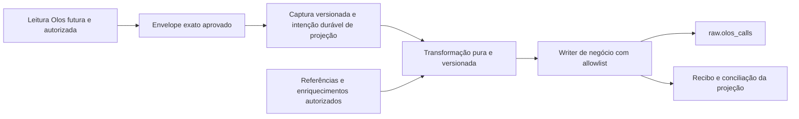

# Auditoria de contrato da Fase 2A para preparação da Fase 2B

Data: 15/10/2026. Projeto: `worker-olos-export-data`.

## 1. Conclusão e limites da auditoria

A Fase 2A oferece uma base de ingestão transacional testada, mas não implementa o contrato de negócio `raw.olos_calls`. A evolução recomendada é manter os envelopes e controles da origem e acrescentar uma projeção de negócio versionada, com identidade, permissões, entrega e conciliação próprios. Trocar apenas o nome da tabela ou o schema do writer atual seria incorreto.

**Não há evidência suficiente para definir o UPSERT definitivo de chamadas.** A empresa forneceu tipos e uma PK para o modelo da Referência 1, mas não os metadados físicos do destino, o layout ExportDataV3, a granularidade de uma chamada ou a equivalência dos identificadores. O mapeamento abaixo é uma proposta condicionada a essas confirmações, não um contrato já aprovado.

Nesta tarefa foi criado somente este documento. Nenhuma migration nova, implementação, contrato de origem, teste ou configuração foi alterado. O build regenerou os artefatos ignorados de `dist/`. O diretório não possui repositório Git inicializado; a preservação dos arquivos existentes foi conferida por hashes locais, sem inicializar Git.

Não foram consultados bancos da empresa, executadas procedures ou habilitada sincronização. Os testes aplicam exclusivamente as migrations existentes em PostgreSQL descartável criado pelo próprio helper. A configuração continua com `SYNC_ENABLED=false` por padrão e rejeita `true`.

### Fontes e grau de confirmação

- **R1 — fornecido pela empresa nesta solicitação:** lista de 23 campos de `raw.olos_calls`, tipos indicados e PK de `raw_olos_call_id`. `data_carga` aparece no SELECT mencionado, mas não nessa definição.
- **R2 — fornecido pela empresa nesta solicitação:** lista de 33 colunas do registro existente. Não foram fornecidos valores, DDL, tipos, constraints, defaults ou o SELECT completo. Uma lista de saída não comprova que todos os nomes sejam colunas físicas da mesma tabela; views, aliases e expressões precisam ser distinguidos.
- **Código confirmado localmente:** migrations 001/002, permissões, persistência, configuração, boot e testes. Isso comprova a implementação atual, não o layout dos bancos reais.
- **Hipótese/proposta:** origem de cada atributo, joins, normalização, geração de IDs, titularidade de campos e evolução futura. Esses pontos estão marcados como pendentes.

Não se presume que tipos de R1 também estejam comprovados em R2. Fora da PK explicitada em R1, não se afirmam nulabilidade, FKs, unicidades, índices, defaults, identity, sequences, triggers, collation ou regras de atualização.

## 2. Achados prioritários

| Achado | Evidência e consequência | Requisito para a Fase 2B |
| --- | --- | --- |
| B01 — contrato físico e granularidade indefinidos | R1 e R2 divergem. Não está definido se uma linha representa chamada, tentativa, evento ou perna de chamada. | Resolver o contrato vigente e a cardinalidade antes de deduplicar ou consolidar fontes. |
| B02 — três identificadores sem equivalência comprovada | Apenas `raw_olos_call_id` tem PK declarada em R1; o código não conhece os três nomes como identidade real da Olos. | Definir origem, escopo, estabilidade e estratégia de atribuição de cada ID. |
| B03 — precisão não garantida na fronteira do driver | Envelopes recebem strings exatas; os testes não exercitam leitura real do SQL Server. Há conversões temporais/numéricas no driver instalado. | Validar a representação antes de qualquer conversão destrutiva ou clone de registros. |
| B04 — preservação apenas do último estado | `persistBatch` sobrescreve `payload`/versão/último lote quando há alteração da mesma chave. Não há snapshots imutáveis de todas as versões recebidas. | Definir retenção e captura versionada para replay auditável; não alegar arquivo integral de origem. |
| B05 — controles independentes no modelo, writer acoplado no código | Não há FK para raw ou CRM, mas `PostgresPersistence` une controle e UPSERT dos seis envelopes em uma função/transação. | Acrescentar projeção separada sem reclassificar checkpoint de origem como sucesso no destino de negócio. |
| B06 — entrega para raw ainda não existe | Não há transformação, outbox, inbox, cursor da projeção ou recibo de entrega de negócio. | Fechar a janela entre commit do envelope e registro durável da intenção de projetar. |
| B07 — risco de sobrescrever estado de outros sistemas | R2 contém 12 campos `kommo_*`; R1 contém vínculos HubSpot e do banco. Ownership/triggers não foram informados. | Atualização por allowlist de campos autorizados, preservando todo estado externo. |
| B08 — ordem de chegada não é versão de negócio | O UPSERT atual compara conteúdo/versão de contrato, sem comparar revisão ou data efetiva da origem. | Definir precedência para releituras antigas, correções e enriquecimentos tardios. |
| B09 — adição ingênua de versão quebra o preflight | `startRun` exige exatamente as versões 1 e 2 em `schema_versions`. | Planejar versionamento compatível; não acrescentar versão 3 nesse ledger sem evolução coordenada. |
| B10 — troca de PostgreSQL pode criar dois donos | Locks/gerações ficam em cada banco. Copiá-los ou expirá-los não cerca um worker ainda ativo no banco antigo. | Cutover com parada verificável, drenagem e reconciliação; não usar escrita dupla informal. |

B01/B02/B03/B06/B07 bloqueiam escrita real segura em raw. B04/B08/B09/B10 exigem tratamento no desenho e nos testes da evolução. Nenhum deles foi corrigido nesta auditoria.

## 3. Inspeção das migrations e da arquitetura

| Artefato inspecionado | O que existe | Compatibilidade e limite |
| --- | --- | --- |
| [001_control.sql](../migrations/001_control.sql) | Schema `olos_export`; 11 tabelas de versões, contratos, streams, runs, locks, batches, checkpoints, erros, casos/tentativas de recuperação e auditoria. Seis contratos reais começam `pending`, sem aprovação. | Não cria `raw`, `olos_calls`, campos CRM ou vínculo a tabelas de negócio. Stream é por tabela/tipo de leitura/data; não contém namespace explícito da instância Olos. |
| [002_operational_envelopes.sql](../migrations/002_operational_envelopes.sql) | Seis tabelas com `source_key`, `source_table`, `contract_version`, `payload`, `last_batch_id` e `updated_at`. Chave textual com collation C; FKs para contrato/lote. Função `safe_payload`. | Não é layout tipado de chamada. A FK identifica o último lote que inseriu/alterou a linha, não todos os lotes em que ela foi vista. |
| [worker.sql](../permissions/worker.sql) | Role sem login, USAGE no schema, permissões nos controles/envelopes e na função de validação. Sem DELETE/TRUNCATE/CREATE ou alteração de contratos. | Não concede acesso ao schema raw. Não comprova ausência de privilégios herdados/PUBLIC no ambiente definitivo. |
| [store.ts](../src/persistence/store.ts) | Intent durável, lease por tabela com geração, lote observado, validação de versão+cursor, UPSERT em parcelas, checkpoint e auditoria na mesma transação; recibo idempotente; recuperação conservadora. | Não lê Olos, não transforma chamadas e não entrega em raw. O destino SQL vem do mapa fixo de seis tabelas. |
| [validation.ts](../src/persistence/validation.ts) e [types.ts](../src/persistence/types.ts) | Allowlist aprovada, chave canônica, valores exatos, deduplicação e limites. | Não incluem validação de CPF/telefone, INTEGER de negócio, CHAR(11), relacionamentos, unidade de TMA ou política temporal de raw. |
| [transaction.ts](../src/persistence/transaction.ts) | Mesmo cliente pg para BEGIN, comandos e COMMIT; rollback; resultado `unknown` em falha de confirmação do COMMIT. | Protege apenas a transação local. Não cobre duas conexões, dois bancos ou efeitos Olos. |
| [contracts.ts](../src/sync/contracts.ts) e [recovery.ts](../src/sync/recovery.ts) | Contratos da fundação e portas futuras LogReadData/ReReadData, sem executor remoto. | O protocolo durável concreto tem tipos próprios na persistência; a projeção não deve tentar representar `raw.olos_calls` como mais uma tabela ExportDataV3. |
| [pools.ts](../src/db/pools.ts), [env.ts](../src/config/env.ts), [app.ts](../src/app.ts), [main.ts](../src/main.ts) | Pools de diagnóstico, TLS/timeouts, PG somente leitura, HTTP, logs e shutdown. Boot não instancia a persistência. `PG_SCHEMA` aceita apenas `olos_export`. | Não mudar `PG_SCHEMA` para raw nem reaproveitar silenciosamente o pool de diagnóstico para escrita. Readiness continua 503 para consumo indisponível. |
| [testes](../test/persistence.test.ts) e [fixture PostgreSQL](../test/support/postgres.ts) | Contrato sintético e PostgreSQL 16 descartável; controles locais verificados. | Nenhum campo sintético confirma colunas/PKs da Olos ou compatibilidade física com raw. |

**Independência da camada de controle:** confirmada quanto ao schema de negócio, CRM e FKs. A implementação ainda é específica da ingestão dos seis envelopes, não um mecanismo plugável de qualquer destino. Lease, run e checkpoint atuais medem ingestão da origem. Uma projeção deve ter seus próprios estados/contagens de negócio e referências de proveniência aos controles de origem; falhar em raw não deve falsificar o sucesso ou reiniciar a leitura Olos.

## 4. Preservação de valores nos envelopes

| Aspecto | Garantia atual | Limite e decisão necessária |
| --- | --- | --- |
| BIGINT | `int64` exige string canônica no intervalo signed int64; números JS são rejeitados. Chave conserva os componentes aprovados sem hash como identidade. | Não recupera bits já perdidos antes da validação. IDs TEXT com zeros à esquerda devem continuar texto, não passar por normalização de inteiro. |
| DECIMAL | String decimal sem conversão para number. | Não comprova precisão/escala de uma coluna real; notação exponencial e number não são aceitos. Formatar um number previamente arredondado como string não recupera exatidão. |
| Timestamp | Strings distinguem horário sem offset e com offset/Z, com até sete dígitos fracionários; sem Date no payload aceito. | Há um subconjunto de formatos aceitos; o serializador da origem ainda não existe. A regra de fuso de um horário civil continua desconhecida. |
| Null/vazio | Null permanece null; string vazia é distinta. Campos precisam existir mesmo quando nullable e null. | Ausência de atributo e null não são a mesma coisa; schema drift causa rejeição, não preenchimento silencioso. |
| Bytes e texto | Bytes viram base64; strings mantêm seu conteúdo aceito. | Base64 é representação, não bytes SQL nativos no JSONB; metadados de tipo ficam no contrato. Encoding/caracteres precisam de testes de fronteira. |
| Estrutura | Apenas campos planos aprovados; strings, booleanos e null no JSONB; proteção adicional contra nomes de senha. | Não é armazenamento de qualquer resposta/objeto original. Não aceita arrays/objetos aninhados ou números JSON. Não preservar `Users.Password` é requisito, não perda a ser corrigida. |
| Histórico | Lote/digest/auditoria documentam a operação; último payload e contrato ficam na linha. | Atualizações substituem o payload anterior. Duplicata inalterada não troca `last_batch_id`. Digest não reconstrói um registro perdido nem fornece associação completa lote→todas as linhas. |
| Fidelidade JSON | Valores escalares aprovados são preservados. | JSONB não é uma cópia textual do documento: ordem/espaçamento/chaves JSON duplicadas não são preservados. [Documentação PostgreSQL](https://www.postgresql.org/docs/16/datatype-json.html). |

A conclusão é **preservação de valores aceitos, condicionada à aquisição exata**, e não preservação integral de todo histórico ou representação de transporte.

### Fronteira SQL Server/JavaScript verificada no driver instalado

Foi inspecionado o código instalado, sem abrir conexão SQL Server:

- `node_modules/mssql/node_modules/tedious/lib/value-parser.js`, `readBigInt`: retorna string a partir do inteiro de 64 bits. Isso é compatível com o envelope, mas não substitui teste futuro da procedure real.
- No mesmo arquivo, `readNumeric` efetua aritmética JavaScript no retorno. Precisões elevadas exigem uma estratégia de aquisição exata anterior à perda; um value handler posterior não pode presumir recuperar dígitos perdidos.
- `readDateTime2` cria Date e anexa `nanosecondsDelta` não enumerável. `readDateTimeOffset` também cria Date e consome o offset sem expô-lo como propriedade preservada nesse retorno. Não é seguro supor que `toISOString()` mantém fração completa e offset original.
- `store.snapshot()` usa `structuredClone` antes da validação. Uma verificação local com Date sintético confirmou que a propriedade adicional `nanosecondsDelta` não sobrevive ao clone. O validador atual rejeita Date; portanto não foi constatada gravação silenciosa desse Date pela implementação atual. O risco está em uma adaptação futura que o converta incorretamente para string.

A Fase 2B deve prever representação exata antes de clone/JSON/Date/number. A solução pode exigir serialização controlada na origem ou suporte apropriado de driver, conforme o contrato real. Não foi validado que as procedures fornecidas permitam converter colunas no servidor, envolver resultados ou reconstruir todos os metadados. Não executar procedures apenas para preencher essa lacuna nesta fase.

## 5. Comparação completa dos dois contratos

R1 tem 23 campos tipados; R2 tem 33 nomes. Há 15 nomes comuns, oito somente na definição R1 e 18 somente em R2. A união contém 41 nomes. `data_carga` é uma exceção explícita: pertence a R2 e ao SELECT mencionado em R1, mas não à definição tipada de R1.

Na matriz, **O?** significa origem Olos candidata, **W?** derivação candidata do worker, **E?** integração/sistema externo candidato, **I?** atribuição ainda indeterminada. Esses marcadores não confirmam ownership. Nenhuma coluna oficial da Olos, expressão de join ou equivalência de nomes foi fornecida.

### 5.1 Todos os 23 campos da definição R1

A coluna de tipo reproduz somente R1. “Sim” em R2 confirma apenas a presença do mesmo nome; seu tipo e significado físico em R2 continuam pendentes.

| Campo R1 | Tipo fornecido em R1 | Mesmo nome em R2 | Classificação e proposta condicionada de preenchimento |
| --- | --- | --- | --- |
| raw_olos_call_id | BIGINT, PK | Sim | I? Identidade da linha do destino. Confirmar se importada, atribuída por outra aplicação ou gerada no banco. Não assumir sequence/identity/default, nem copiar outro ID. |
| olos_call_id | TEXT | Sim | O? Candidato a identificador funcional da chamada. Exige campo oficial, estabilidade e escopo comprovados; manter representação textual integral. |
| data_ligacao | TIMESTAMP | Sim | O? Definir evento representado: início da tentativa, discagem, atendimento ou outro. Selecionar fonte e política de fuso/precisão aprovadas. |
| telefone | TEXT | Sim | O?/E? Definir participante relevante por direção: discado, chamador, destino/ramal etc. Pode depender de mailing/lead; não adivinhar. Preservar valor original autorizado. |
| telefone_normalizado | TEXT | Não | W? Só gerar segundo regra da empresa para país/DDD, prefixos, extensão e inválidos; não substituir telefone original. |
| telefone_match_key | TEXT | Sim | W?/E? Chave de matching existente sem algoritmo/owner informado. Não equiparar automaticamente a telefone_normalizado. Preservar valor legado até contrato de atualização. |
| cpf | TEXT | Sim | O?/E? Não foi comprovada presença nas seis tabelas de origem. Exige atributo oficial/customizado ou fonte de lead autorizada. |
| cpf_normalizado | CHAR(11) | Não | W? Exige regra de normalização/validação e tratamento de inválido/null. CHAR(11) não confirma onze dígitos nem autorização para completar zeros. |
| email | TEXT | Sim | O?/E? Fonte não comprovada; pode vir de mailing/CRM/base própria. Não fabricar a partir de identificação de agente ou de telefone. |
| nome_agente | TEXT | Sim | O? Users é candidata a referência. Validar chave de associação e se nome é histórico do evento ou valor atual da dimensão. Não fazer join por nome. |
| id_campanha_olos | TEXT | Sim | O? Campo identificador oficial a confirmar; preservar zeros/case se parte da representação. Não é automaticamente produto_id. |
| nome_campanha_olos | TEXT | Sim | O? Campaign é candidata. Confirmar relacionamento, disponibilidade e temporalidade da dimensão. |
| produto_id | BIGINT | Não | E? Catálogo/regra de campanha→produto ainda não fornecido. Exigir chave/validade do relacionamento, sem derivar por igualdade numérica ou pelo nome da campanha. |
| id_tabulacao_olos | TEXT | Sim | O? Identificador de resultado a confirmar, incluindo escopo por campanha/tenant se aplicável. Não presumir uma enumeração global. |
| nome_tabulacao_olos | TEXT | Sim | O? Disposition é candidata. Confirmar chave e significado; não tratar como razão de desligamento. |
| tma_segundos | INTEGER | Não | O?/W? Exige definição de TMA e unidade, inclusão de espera/atendimento/pós-atendimento, agregação e arredondamento. `tma_origem` é apenas candidato, não equivalente aprovado. Validar intervalo INTEGER antes do cast. |
| razao_desligamento | TEXT | Sim | O?/E? Definir campo ou dicionário de códigos, lado que desligou e regra de precedência. Nenhuma tabela/campo oficial foi confirmado. |
| lead_id_banco | BIGINT | Não | E? ID do lead no banco da empresa. Resolver por fonte/relação autorizada. `lead_id_origem` não prova mesma entidade, namespace ou tipo. |
| deal_id_banco | BIGINT | Não | E? Relação com negócio no banco da empresa ainda ausente. Não inferir pelo ID do lead. |
| hubspot_contact_id | TEXT | Não | E? Identidade gerenciada pela integração HubSpot. Lookup/ownership a confirmar; não usar ID Kommo ou ID local como substituto. |
| hubspot_deal_id | TEXT | Não | E? Identidade do deal HubSpot, independente do contato/lead/deal local. Não derivar por nome ou igualdade numérica. |
| created_at | TIMESTAMP | Sim | I?/E? Definir se criação da linha raw, timestamp importado ou default do destino. Não equiparar a início da ligação ou horário de ingestão. Preservação em replay depende do contrato. |
| updated_at | TIMESTAMP | Sim | I?/E? Definir owner, trigger/default e o que constitui atualização. Não copiar `olos_export.*.updated_at` como se fosse a mesma semântica. |

### 5.2 Todos os 18 campos adicionais de R2

**Tipo, nulabilidade, default e constraints de cada campo abaixo não foram fornecidos.** Não atribuir tipos a hashes, IDs, contadores, datas ou lotes apenas pelo nome.

| Campo R2 sem definição em R1 | Situação e tratamento proposto |
| --- | --- |
| internal_id_olos | I?/O? Papel desconhecido: identidade da origem, importador ou legado. Não equiparar a olos_call_id/raw_olos_call_id, nem criar UNIQUE sem evidência. |
| lead_id_origem | I?/E? Identidade da origem do lead com namespace/tipo desconhecidos. Manter distinto de lead_id_banco até obter relacionamento comprovado. |
| tma_origem | O?/I? Medida original sem unidade/semântica/tipo informados. Preservar antes de qualquer transformação; não renomear diretamente para tma_segundos. |
| arquivo_origem | I?/W? Metadado legado possivelmente ligado a carga de arquivo. Uma leitura por procedure não tem necessariamente arquivo correspondente; não fabricar nome/caminho. |
| lote_carga | I?/W? Sem definição de tipo, cardinalidade ou responsabilidade. Não copiar automaticamente UUID de batches.id nem assumir que agrupa exatamente um lote do worker. |
| data_carga | I?/W? Consta do SELECT mencionado em R1 e de R2, sem tipo/definição. Confirmar coluna física/alias/expressão, owner e fuso. Não criar coluna nem substituir por created_at/export_date/committed_at. |
| kommo_event_hash | E? Provável estado do pipeline Kommo, a confirmar. Não calcular com batches.digest nem usar para deduplicar chamada. |
| kommo_event_hash_processado | E? Sem contrato de comparação e atualização. Preservar separado do hash corrente e não marcar como processado pelo worker. |
| kommo_status_processamento | E? Estado externo com enumeração/default desconhecidos. Não reinicializar em UPSERT/backfill. |
| kommo_lead_id_encontrado | E? Resultado de resolução no Kommo, não identidade comprovada de lead local ou contato HubSpot. Não preencher ou reaproveitar. |
| kommo_match_origem | E? Proveniência do matching externo; não substituir por método de normalização do worker. |
| kommo_tentativas | E? Contador externo com política desconhecida; não incrementar, zerar ou converter sem metadados. |
| kommo_processado_em | E? Instante/horário de processamento externo, tipo/fuso pendentes. Preservar, não usar como data da ligação/carga. |
| kommo_erro | E? Diagnóstico externo; não copiar para logs do worker, pois pode conter dados pessoais. Não limpar ou substituir. |
| kommo_pipeline_id_atual | E? Estado CRM externo. Não tratar como produto/campanha nem atualizar pela projeção Olos. |
| kommo_status_id_atual | E? Estado CRM externo, diferente de resultado de tabulação salvo confirmação expressa. Preservar. |
| kommo_batch_id | E? Identidade de lote externo, não equivalente ao lote da ingestão. Não reutilizar batches.id. |
| kommo_reservado_em | E? Possível mecanismo de reserva externa. Não liberar, renovar ou interpretar como lease do worker sem contrato. |

O prefixo Kommo sugere um sistema externo, mas não comprova implementação ou owner. A política conservadora proposta é **não escrever nesses campos**, até aprovação explícita da empresa. O mesmo cuidado se aplica a HubSpot, vínculos locais e timestamps de ownership indeterminado.

### 5.3 Equivalências que não estão aprovadas

- `internal_id_olos = olos_call_id = raw_olos_call_id`.
- `lead_id_origem = lead_id_banco = kommo_lead_id_encontrado`.
- `deal_id_banco = hubspot_deal_id`; contato HubSpot também não é lead Kommo.
- `tma_origem = tma_segundos`.
- `telefone_match_key = telefone_normalizado`.
- `arquivo_origem/lote_carga/data_carga = tabela/run/batch/export_date` do worker.
- `kommo_event_hash = batches.digest`; hash de evento não é automaticamente ID de chamada.
- `created_at`, `updated_at`, `data_carga`, `data_ligacao` ou timestamps internos como o mesmo relógio/acontecimento.

## 6. Informações e regras de negócio ainda necessárias

Antes de implementar escrita de negócio, solicitar evidências, sem executar consultas reais nesta auditoria:

1. DDL vigente e SELECT completo das duas referências, incluindo schema/tabela/view, aliases, tipos reais, precisão temporal, nullability, PK/UNIQUE, índices parciais/expressões, sequences/identity, defaults, triggers, FKs, collation e permissões. Resolver explicitamente a divergência de data_carga e dizer qual contrato é normativo.
2. Dicionário oficial ExportDataV3 correspondente à instalação: nomes/tipos das colunas exportadas, chaves, partições, parâmetros e efeitos das procedures. Os seis nomes de tabela existentes não bastam para preencher a matriz.
3. Granularidade de raw e correlação entre AttemptsRawData, InboundRawData e PbxBillingData: chamadas podem ter múltiplas tentativas/pernas/registros; não foi demonstrado que um registro de cada fonte corresponda à mesma linha de negócio.
4. Origem, escopo e estabilidade dos três IDs; política para ID ausente/nulo/reutilizado, tenant/instância/campanha/partição e possíveis colisões históricas. Perfil de duplicatas autorizado é evidência complementar, não prova sozinho uma constraint de domínio.
5. Relacionamentos aprovados com Users/Campaign/Disposition e política de dimensões ausentes, tardias ou renomeadas. Definir nome histórico versus atual e a versão de referência utilizada em cada transformação.
6. Fonte de telefone/CPF/e-mail e autorização para coleta mínima; regras de normalização, validação, matching, precedência e colisões. Telefone/CPF/e-mail não são identidade de chamada.
7. Catálogos e regras de produto, lead/deal local e relações com HubSpot/Kommo, incluindo IDs imutáveis e validade temporal. Definir quais serviços preenchem cada atributo.
8. Unidade e composição de TMA, evento de data_ligacao, razão de desligamento e arredondamento. Definir regras para inválidos e campos não resolvidos; não preencher zero, string vazia ou null sem política/nulabilidade confirmadas.
9. Política de tempo civil/instante, fuso da origem e do negócio, preservação de offset, precisão, data de carga/criação/atualização e replay. O timezone desta máquina não constitui regra de negócio.
10. Matriz de ownership por coluna e efeito dos triggers: inserir, atualizar, completar posteriormente ou nunca escrever. Omitir uma coluna só é viável se o contrato real permitir omissão; não presumir default/nullable para contornar campos desconhecidos.

## 7. Deduplicação e identidade

### 7.1 Três identidades distintas até prova em contrário

| Identificador | O que está confirmado | O que falta | Decisão segura agora |
| --- | --- | --- | --- |
| raw_olos_call_id | BIGINT e PK no modelo R1; nome também consta em R2. | Tipo/PK física de R2, origem/geração, estabilidade entre bancos e relação com dados existentes. | Preservar em strings fora do PostgreSQL. Não gerar, renumerar, assumir sequence ou derivar de outro ID. |
| olos_call_id | TEXT em R1, nome presente em R2. | Unicidade, não nulidade, granularidade e escopo global/particionado. | Preservar texto, case e zeros. Não declarar UNIQUE, não fazer ON CONFLICT nesse campo e não converter para number. |
| internal_id_olos | Somente nome em R2. | Tipo, origem, geração, escopo e eventual equivalência. | Preservar como atributo conhecido apenas após contrato; não escolher como chave de ingestão/projeção. |

Uma PK substituta do destino impede colisões dessa PK, mas não deduplica chamadas reingeridas se uma nova PK for atribuída a cada tentativa. Se a empresa comprovar que um desses IDs é uma identidade natural global e estável, poderá ser a base de um conflito único revisado. Se a unicidade for composta, todos os componentes e namespaces precisam de evidência; esta auditoria não fixa uma composição.

### 7.2 O que a deduplicação da Fase 2A garante

`source_key` é construída a partir de `key_fields` aprovados e identifica um registro de uma tabela de origem. Payload igual dentro/entre lotes é contado como duplicado; conteúdos divergentes com a mesma chave no mesmo lote são rejeitados. Replay do mesmo batch ID exige o mesmo digest, e batch já committed devolve seu recibo sem regredir checkpoint. Isso é diferente de identificar uma chamada consolidada em raw.

O digest do lote inclui UUID, expectativa de checkpoint, cursor seguinte, contrato e sequência de registros; muda com agrupamento/ordem/metadados. Não serve como identidade de chamada nem como hash Kommo. Uma mensagem de projeção futura deve ter identidade durável e estável no replay, além de vinculação aos registros/versões de origem.

O estado atual não contém identificador explícito da instância SQL Server no stream/source_key. Ao combinar ou migrar bases, é necessário manter um namespace de origem estável em metadados aprovados e comprovar a chave nesse escopo. Nome do banco, hostname de destino ou endpoint novo não devem redefinir silenciosamente a identidade lógica da fonte.

### 7.3 Concorrência e ordem da projeção

A lease atual cerca uma tabela Olos por vez no mesmo banco PostgreSQL. Se duas fontes projetarem a mesma chamada, esses locks distintos não oferecem exclusão sobre a identidade de negócio compartilhada. O destino precisará de unicidade comprovada e controle de aplicação de revisões/entregas, sem bloquear sistemas externos com uma falsa lease global.

Não usar horário de ingestão ou versão do checkpoint como prova de revisão de negócio. Uma releitura histórica ou dimensão desatualizada pode sobrescrever dados mais recentes pelo UPSERT atual. Definir precedência e tratamento de conflitos antes de permitir correções em raw. Em conflito sem prova, preservar evidência e encaminhar para conciliação, sem escolher arbitrariamente o último recebido.

## 8. Proposta de mapeamento e arquitetura da Fase 2B

Proposta conceitual; nenhum componente abaixo foi implementado nesta auditoria.

1. **Aquisição exata:** transformar os tipos do protocolo para representações preservadas antes de entrar no lote atual, sem perder IDs, frações ou offset. Contrato da origem e exclusão de Password continuam independentes do modelo raw.
2. **Captura/proveniência:** manter envelope aprovado e, se exigido replay histórico, snapshot imutável de cada versão necessária e associação completa aos lotes. Guardar a representação original antes de normalizar telefone/CPF/TMA; não confundir “original” com copiar campos pessoais desnecessários.
3. **Transformação pura:** receber registros/versões e referências explicitamente selecionadas e produzir uma proposta raw ou pendências tipadas. Versionar mapeamento, normalizador e política temporal. Não fazer chamadas CRM ou SQL dentro dessa função. Não inferir joins por nomes ou produzir linhas com multiplicação silenciosa.
4. **Enriquecimento:** resolver as fontes adicionais da matriz por interfaces separadas e política de validade. Ausência/ambiguidade deve permanecer pendência, não virar um relacionamento fabricado. Definir quando uma chamada pode ser publicada parcialmente ou deve aguardar completude.
5. **Writer de negócio:** SQL parametrizado e destino fixo/revisado, separado do mapa de seis envelopes. Inserir/atualizar somente colunas de ownership aprovado; manter todos os IDs originais e uma relação auditável com a identidade raw escolhida. Não atualizar `kommo_*`, HubSpot ou outros vínculos só porque constam do objeto de entrada.
6. **Controle de projeção:** diferenciar origem persistida, transformação pendente, enriquecimento pendente, entrega confirmada, rejeição e resultado remoto desconhecido. Os nomes/tipos físicos desses estados ainda serão revisados. Não reutilizar cursor/last_success_at da origem como recibo de raw.

O `PostgresPersistence` atual não recebe um writer de negócio nem expõe a transação para uma outbox. Acrescentar a intenção de projeção depois de `await persistBatch()` deixaria uma janela de crash sem intenção durável. Além disso, o caminho de replay committed retorna antes dos UPSERTs; colocar efeitos de negócio apenas depois desse retorno não garante recuperação de projeções faltantes.

**Proposta preferencial:** registrar snapshot/intenção de projeção atomicamente com o commit da ingestão, por um ponto de composição transacional restrito ao mesmo cliente pg e sem efeitos de rede. Conservar o comportamento padrão da Fase 2A e seus testes; acrescentar testes específicos da composição. O worker de projeção confirma raw e o recibo local de entrega na mesma transação quando compartilham o mesmo PostgreSQL/database.

Se raw estiver em outro database/servidor, mesmo em PostgreSQL, são duas transações. Usar intenção durável na origem e processamento idempotente/recibo no destino, com chave de entrega estável e conciliação. Ack perdido não autoriza presumir sucesso ou criar nova identidade. Não prometer atomicidade distribuída ou exatamente uma execução.

As contagens da ingestão continuam representando registros Olos; contagens de raw precisam separar criados, alterados, inalterados, pendentes e rejeitados segundo regra aprovada. Um join/agregação impede presumir que quantidade de registros Olos seja igual a quantidade de chamadas.

## 9. Requisitos temporais

Na interpretação PostgreSQL, `TIMESTAMP` de R1 significa **timestamp without time zone**. Isso não confirma precisão explícita, fuso civil pretendido ou metadados físicos de R2. TIMESTAMPTZ representa um instante, sem reter o offset original de entrada; casts entre os dois tipos podem depender de TimeZone da sessão. PostgreSQL limita a precisão fracionária a seis dígitos. [Documentação PostgreSQL 16](https://www.postgresql.org/docs/16/datatype-datetime.html).

Consequências para a Fase 2B:

- Não trocar o tipo de R1 para TIMESTAMPTZ por preferência técnica. Confirmar primeiro se data_ligacao é horário civil ou instante e qual consumidor depende disso.
- Uma string sem offset não deve ganhar Z por suposição. Para converter horário civil em instante, a empresa deve fornecer fuso/regra histórica e decisão para horários ambíguos/inexistentes.
- Ao projetar instante em TIMESTAMP, definir explicitamente a zona civil de apresentação; não deixar a sessão decidir. Ao manter TIMESTAMP civil, enviar valor sem offset de forma controlada. Preservar representação exata no envelope.
- Uma origem datetime2(7) pode exigir sete dígitos, como permite o [SQL Server](https://learn.microsoft.com/en-us/sql/t-sql/data-types/datetime2-transact-sql?view=sql-server-ver16). Não cabem integralmente no TIMESTAMP PostgreSQL. Definir e testar arredondamento/truncamento na projeção e manter o original exato para auditoria; não afirmar igualdade temporal integral no destino tipado.
- Separar evento de chamada, data civil de exportação, observação/commit, criação/alteração da linha raw e processamento CRM. Não preencher um relógio com outro sem contrato.
- Evitar ida e volta por Date ao migrar/projetar valores exatos. O [node-postgres](https://node-postgres.com/features/types) converte tipos temporais para Date por padrão e documenta efeitos de timezone/precisão. Usar leitura textual explícita ou parsers por conexão/consulta revisados, sem alterar globalmente o parser que sustenta o controle atual.

Os timestamps TIMESTAMPTZ dos controles existentes podem permanecer como estão. A diferença de tipos entre controle e negócio é válida quando cada um mantém sua semântica. Para CPF, CHAR(11) tem comportamento de preenchimento por espaços e não é validação de CPF; regras de dígitos/comprimento precisam ser externas ao nome do tipo. [Tipos character PostgreSQL](https://www.postgresql.org/docs/16/datatype-character.html).

## 10. Proposta de evolução das migrations — sem criar SQL nesta tarefa

1. Manter 001 e 002 sem edição retroativa, assim como os 65 testes. Preservar `olos_export` como área de origem/controle, sem renomeá-la para raw.
2. Após confirmação do DDL, decidir se raw é objeto existente a consumir ou estrutura nova aprovada pela empresa. Não criar uma cópia supostamente definitiva, coluna data_carga ou campos Kommo por inferência a partir das listas.
3. Preparar futuramente mudanças aditivas revisáveis para captura/proveniência, intenção/recibo de projeção e relacionamento entre identidade de origem e raw, caso aprovados. Os tipos, constraints e nomes físicos desses novos controles pertencem a uma especificação posterior; este documento não os declara existentes.
4. Versionar o contrato do destino, mapeamento e regras de normalização/tempo separadamente do contrato ExportDataV3. Preferir ledger de capacidades/versões da projeção separado do ledger de ingestão enquanto as estruturas antigas forem compatíveis. `startRun` hoje aceita somente as versões 1 e 2: registrar 3 ali, sem atualizar o preflight, bloquearia o worker.
5. Se alguma evolução exigir alterar o ledger/core de ingestão, planejar migração e código em conjunto, com conjuntos de versões explicitamente suportados e testes de ausência, versões extras e drift. Não simplesmente trocar a verificação por `max(version)>=2` ou remover o bloqueio.
6. Aprovar contratos de origem novos com evidências e versões imutáveis do ponto de vista operacional. O role do worker não pode editá-los, mas não existe garantia SQL de imutabilidade contra administradores. Alterar campos/chaves de uma versão já usada pode invalidar digest, replay e identidade; não fazer isso em operação.
7. Revisar grants para um escritor/projetor de negócio dedicado, preferencialmente por coluna conforme ownership. A concessão atual não autoriza raw. O pool de diagnóstico deve continuar somente leitura. Rever também triggers e roles herdados antes de afirmar que os campos externos estão protegidos.
8. Cada mudança futura deve ter plano manual de aplicação, validação, backup e reversão compatível com os dados. Não prever DROP/TRUNCATE automático de dados para “corrigir” divergências.

Preservar testes não significa manter a implementação congelada para sempre: mudanças futuras nos pontos transacionais exigirão novos testes além dos 65, sem remover ou enfraquecer suas garantias atuais. Não há migração automática no boot, instalação, build ou start.

## 11. Migração futura entre bancos PostgreSQL

### 11.1 Riscos que precisam ser tratados

| Risco | Tratamento proposto |
| --- | --- |
| Copiar somente raw ou somente os checkpoints | Migrar um conjunto consistente de envelopes/capturas, contratos, lotes, runs, checkpoints, erros, recuperação e estados de entrega necessários à continuidade. Sem isso, recibos podem não corresponder aos dados. |
| Copiar snapshot enquanto os escritores avançam | Definir snapshot consistente e estratégia explícita de delta ou parada. Um dump consistente não inclui mudanças posteriores automaticamente. |
| Reusar raw_olos_call_id com destino já populado | Inventariar colisões, FKs e referências externas antes da carga. Não resolver colisão com DO NOTHING ou renumeração silenciosa. Preservar IDs; se remapeamento for aprovado, conservar relação auditável e atualizar todos os vínculos autorizados. |
| Atribuição de IDs desconhecida | Inventariar sequences/identity somente se existirem. Restaurar seu estado compatível com os IDs copiados antes de liberar inserções; não assumir uma sequence nem um simples MAX+1 para todo caso. |
| Transportar só os campos R1 e perder R2 | Preservar colunas e estados existentes sob responsabilidade da equipe proprietária. Migração administrativa do legado não é o mesmo fluxo de coleta mínima do worker. Não zerar hashes, reservas, contadores ou vínculos CRM. |
| Dependências fora de olos_export/raw | Revisar FKs, catálogos, funções, triggers, extensões, owners e grants; não modificar public como efeito colateral. Resolver lead/deal/produto por identidades corretas, não por coincidência numérica entre bases. |
| Encoding/collation/versões diferentes | Conferir UTF-8, collation, comparação de chaves, versões PostgreSQL e compatibilidade de ferramentas. Não comparar amostras de strings como prova de integridade completa. |
| Trânsito por JS/CSV sem contrato de tipos | Evitar number/Date, coerção de null, perda de zeros, padding CHAR, escape de texto ou perda de precisão. Validar contagens e valores/digests canônicos sem logs de PII. |
| Restaurar locks/leases ativos | Parar e verificar ausência dos escritores antigos antes da cópia/retomada. Dois bancos têm domínios independentes de lock; geração copiada não faz fencing remoto no banco antigo/Olos. |
| Entregas em voo/COMMIT desconhecido | Drenar ou registrar pendências e conciliar recibos nas duas pontas antes de liberar reprocessamento. Não gerar IDs novos para “destravar”. |
| Mudar de destino e reaproveitar confirmação antiga | Identificar logicamente o destino e registrar quais entregas/versões foram realmente copiadas. Confirmação em A não comprova presença em B sem verificação. Endpoint físico novo não deve mudar identidade da origem. |
| Rollback depois de avanço no novo banco | Não reiniciar o banco antigo a partir do snapshot anterior, nem redefinir o controle Olos. Planejar retorno dos deltas/recibos e conciliação; caso contrário, bloquear avanço. |

O [pg_dump](https://www.postgresql.org/docs/16/app-pgdump.html) é uma opção para snapshot consistente. Dump de um database não inclui roles globais e seleção de schemas não garante incluir suas dependências externas. A ferramenta deve ser compatível com a versão do servidor; restauração para uma versão major mais antiga não é garantida. Essas limitações precisam do ensaio de migração, não de comandos automáticos no worker.

### 11.2 Plano de execução futuro, sujeito a autorização específica

1. **Inventário e contrato:** identificar bancos envolvidos, schemas/objetos, consumidores, geradores de ID, dependências e regras aprovadas da seção 6. Distinguir migração para base vazia de merge com legado já existente.
2. **Ensaio isolado:** preparar destino descartável com DDL confirmado e dados sintéticos autorizados; testar carga, constraints, permissões, precisão, colisões, idempotência e rollback operacional. Não usar dados pessoais reais por conveniência.
3. **Manifesto da migração:** registrar escopo, versões, identidades lógicas, snapshot, contagens por fonte/estado/partição e digests apropriados. Preservar referências entre envelopes, lotes e projeções.
4. **Quiescência:** parar extração, projeção e escritores externos relevantes ao escopo; drenar transações, fechar conexões e registrar pendências/unknown. Verificar que a instância antiga não segue escrevendo, em vez de apenas esperar TTL de lease.
5. **Cópia autorizada:** obter snapshot consistente e transportar o conjunto revisado com identidades intactas. Criar/aplicar objetos somente com revisão manual, respeitando a propriedade dos schemas e estados externos. Não apagar o legado.
6. **Conciliação:** verificar versões, dados exatos, nulls, IDs, relações, timestamps, pendências e recibos nas duas pontas; restaurar geradores existentes e grants. Contagem total sozinha não demonstra equivalência.
7. **Cutover controlado:** apontar um único conjunto de workers para o novo banco, testar diagnóstico e comprovar ausência do escritor antigo. Não reabilitar consumo Olos sem a autorização/validação da fase operacional correspondente.
8. **Observação e retorno:** manter o banco antigo preservado e sem escrita, documentar janela de reversão e critérios de parada. Se houver novos commits/avanço remoto, conciliar deltas antes de qualquer retorno.

Nenhum dump, restore, alteração de conexão real, cópia ou cutover foi executado nesta tarefa.

## 12. Critérios de aceite propostos para a Fase 2B

### Contrato e ownership

- A empresa aprova o contrato normativo, DDL vigente e a divergência de data_carga; tipos/defaults/constraints de R2 deixam de ser suposições.
- A granularidade da chamada e cada relacionamento entre fontes são documentados, incluindo multiplicidades e referências tardias.
- A identidade e a política de deduplicação dos três IDs têm evidência, namespace, estabilidade, tratamento de null/colisão e estratégia para destino já populado.
- Cada um dos 41 nomes da união tem owner e decisão explícita: fonte, cálculo, enriquecimento, somente preservação ou fora do escopo da escrita. Ausência no destino não autoriza inventar coluna.
- Normalização de telefone/CPF, matching, TMA, razão de desligamento e política temporal estão aprovados. IDs HubSpot/Kommo/local não são intercambiáveis.

### Implementação futura sem extração real por padrão

- Projeção pura e versionada, writer separado com allowlist, proveniência e entrega durável são adicionados preservando interfaces/garantias existentes.
- Envelope exato e intenção de projeção não têm janela de perda entre commits locais; entrega entre databases trata incerteza e idempotência explicitamente.
- Checkpoints da origem e da projeção permanecem separados, com contagens adequadas a registros versus chamadas. Replay committed da origem não esconde projeção pendente.
- Atualizações limitam-se às colunas autorizadas e respeitam comportamento confirmado de triggers. Nenhum campo externo é apagado/zerado por omissão ou null indevido.
- Migrations futuras são apenas preparadas/revisadas manualmente no escopo autorizado; compatibilidade dos ledgers é testada. Não há runner automático, exclusão/truncamento operacional ou aprovação implícita de contratos.
- `SYNC_ENABLED=false`, ausência de executor de procedures nesta etapa e proteção de endpoints/logs continuam intactas. Readiness não declara consumo funcional antes da integração autorizada.

### Testes novos a acrescentar aos 65 existentes

| Grupo | Evidência mínima esperada |
| --- | --- |
| Mapeamento | Todos os campos e ownership; joins 1:N; referências ausentes/renomeadas; origem versus valor calculado; não equivalência dos IDs e dos campos CRM. |
| Precisão | BIGINT acima de MAX_SAFE_INTEGER; extremos; TEXT com zeros/case; DECIMAL; fronteira real do parser em dados sintéticos; clone antes/depois da serialização exata. |
| Tempo | Sem offset/com offset, sétimo dígito e política explícita no destino, horários ambíguos/inexistentes, TZ do processo/sessão diferente, criação/carga/atualização distintas. |
| Regras de negócio | Telefone/CPF inválidos ou vazios, null versus ausente, CHAR(11), colisões de matching, unidade/arredondamento/overflow de TMA, enriquecimentos ambíguos. |
| Idempotência | Replay de lote/mensagem, chamada atravessando várias fontes, chave composta/particionada se comprovada, colisão no legado, correção e releitura antiga sem regressão. |
| Falhas | Crash entre ingestão e intenção, durante projeção e após COMMIT/antes de ack; indisponibilidade de cada banco; receipt no destino; nenhuma nova leitura Olos para corrigir só projeção. |
| Concorrência | Run A antigo versus B; duas fontes na mesma chamada; dois projetores; alterações simultâneas por sistemas externos sem sobrescrita de campos alheios. |
| Migração | Ensaio entre dois PostgreSQL isolados, IDs/estados preservados, namespaces, sequences existentes, permissões, collation, pendências, escritor antigo parado e rollback com deltas. |

Esses testes e aprovações não demonstram, sozinhos, a semântica das procedures ou ausência de perda remota. A validação ExportDataV3 continua sendo requisito separado para a extração real.

## 13. Validação executada nesta auditoria

| Comando | Resultado |
| --- | --- |
| `npm run typecheck` | Aprovado, exit 0. |
| `npm run build` | Aprovado, exit 0. |
| `npm test` | Aprovado: 65 testes em 9 arquivos, exit 0. |

A suíte utilizou mocks e PostgreSQL 16 descartável com senha efêmera e porta efêmera somente em loopback. O helper não aceita URL PostgreSQL externa nem usa o banco configurado da empresa como fallback. Aplicou somente os SQLs já existentes nesse fixture e removeu seu container no teardown.

Não foram criados testes novos, enfraquecidas asserções ou alterados arquivos existentes para obter aprovação. Os 65 testes comprovam as garantias locais já implementadas; **não comprovam mapeamento, escrita em raw, timezone de negócio, compatibilidade com o legado, precisão ponta a ponta do SQL Server ou migração entre bancos**.

Foi comparado o hash dos arquivos existentes em `src`, `test`, `migrations`, `permissions`, `docs` e dos arquivos de configuração/documentação do projeto: nenhum foi alterado. A única adição de projeto desta tarefa é `docs/phase2b-contract-audit.md`; os artefatos de build permanecem em `dist/` ignorado.

Nenhum banco real foi modificado. Nenhuma stored procedure, extração, migration nova, commit, push, deploy ou alteração de WireGuard foi executada. Sincronização não foi habilitada.
