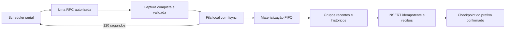

# Ativação operacional do Worker Attempts

Este fluxo é opt-in pela configuração `olos-service/v2`, na CLI existente
`worker:attempts`. O boot genérico e a configuração v1 continuam compatíveis.
Nenhum comando deste documento foi executado contra a Olos durante o desenvolvimento.
Os exemplos com `<...>` são incompletos propositalmente: precisam de informações e
aprovações reais. Não copiar aprovações de fixtures ou de outra operação.

## Estados e armazenamento

- `BOOTSTRAP`: captura única em quarentena, revisão explícita e importação local.
  Não depende de `first-confirmed.json`, nem o fabrica. Cada procedure tem sua
  própria captura/revisão. Não inicia scheduler.
- `ACTIVE`: ativação persistente vinculada aos dois contratos observados, aos
  lotes persistidos e validados e ao documento de recuperação externo. A entrega
  pode continuar pendente na fila V2 após reconciliação local. Um RPC por ciclo;
  próximo ciclo 120 segundos **após o handoff durável da captura**, sem esperar
  a entrega do histórico. Continua sem sobreposição de RPCs.
- `RECOVERY_REQUIRED`: caso pendente, erro ou requisito revogado/inválido. Uma
  resposta completa pode ser importada localmente; parcial não provoca nova leitura.

Usar um diretório privado novo, direto sob
`~/.local/state/olos-worker/corporate-attempts`, por exemplo `service-run`.
Não reutilizar diretórios históricos. A raiz de serviço contém:

```text
activation.json                         # exclusivo; só depois dos requisitos reais
reviews/ReadDataCurrentDay.json
reviews/ReadDataPreviousDays.json
attempt-<novo-uuid>.json                 # intenção sincronizada antes da conexão
cases/<novo-uuid>/remote-state.json      # REMOTE_OUTCOME_UNKNOWN antes do socket
cases/<novo-uuid>/capture/               # LocalSpool: bytes TDS, digest e metadados
cases/<novo-uuid>/diagnostic.json        # fases/códigos sanitizados
cases/<novo-uuid>/contract-candidate.json
cases/<novo-uuid>/import/                # replay/ingestão local, outro LocalSpool
cases/<novo-uuid>/delivered.json         # ACKs de todo o lote; checkpoint contíguo por stream
cases/<novo-uuid>/remote-pending.completed.json # fluxo serial de bootstrap
cases/<novo-uuid>/queued.json            # identidade/ordem da fila independente
cases/<novo-uuid>/remote-pending.captured.json # captura durável, NÃO entrega
queue-mode.json                         # protocolo de entrega independente
cycles/<instante>-<uuid>.json            # histórico sanitizado de ciclos
```

Diretórios `0700`, arquivos exclusivos `0600`, fsync de arquivos/diretórios.
`remote-pending.json` global impede outra aquisição inclusive por uma instância
antiga. O pending é **arquivado**, nunca apagado para liberar uma leitura incerta.
O lock consultivo PostgreSQL `(740219,1)` é o mesmo das rotas anteriores; o processo
mantém a conexão do lock durante a execução. A perda dessa conexão cancela o ciclo.
Todos os processos devem usar o mesmo estado privado persistente.

## Configuração e autorização persistente

Preparar privadamente `~/.config/olos-worker/attempts-service.json`:

```json
{
  "version": "olos-service/v2",
  "workerId": "<identidade estável desta instalação>",
  "endpoint": {
    "server": "10.196.234.11", "port": 1433, "database": "ExportDataV3",
    "user": "OEC", "password": "<credencial existente, somente no arquivo privado>"
  },
  "postgres": {"host": "<host atual>", "port": 5432, "database": "olos_worker"},
  "pinApprovalFile": "/caminho/privado/pin-aprovado.json",
  "approvalFile": "/caminho/privado/service-approval.json",
  "profile": "<objeto do perfil de 16 colunas aprovado já existente>",
  "campaignFile": "/caminho/privado/campaigns.json",
  "dispositionFile": "/caminho/privado/dispositions.json"
}
```

`profile` deve ser um objeto, não a string acima. Manter o perfil existente, com
`phoneMatchKey=normalized`, `tmaPolicy=disabled` e as 16 colunas na ordem de
`APPROVED_COLUMNS`. O destino deve coincidir exatamente com o retorno de
`localSettings` (`worker-local.env` e configuração PostgreSQL já existentes).
Não alterar credenciais, banco, roles, volumes ou rede para contornar uma rejeição.

Obter o digest local **antes** de emitir a autorização, sem conexão à origem:

```bash
npm run worker:attempts -- service-status \
  --config "$HOME/.config/olos-worker/attempts-service.json" \
  --work-dir "$HOME/.local/state/olos-worker/corporate-attempts/service-run"
```

O responsável prepara o arquivo indicado em `approvalFile`, `0600`, com valores
reais (a aplicação não cria, renova nem aprova esse documento):

```json
{
  "scope": "OLOS_ATTEMPTS_SERVICE",
  "approvalId": "<id de aprovação>",
  "workerId": "<mesma identidade>",
  "configurationDigest": "<digest retornado pelo status>",
  "procedures": ["ReadDataCurrentDay", "ReadDataPreviousDays"],
  "table": "AttemptsRawData",
  "destination": "olos_worker.raw.olos_calls",
  "operator": "<responsável>",
  "reference": "<aprovação operacional verdadeira>",
  "issuedAt": "<instante UTC real>",
  "reviewPolicy": "REVOKE_BY_PRIVATE_FILE",
  "revocationFile": "/caminho/privado/service-revoked.json",
  "bootstrapRecoveryEvidence": "<aprovação do procedimento externo para interrupção da primeira captura>"
}
```

Não há expiração administrativa de 12 horas no v2. A existência do arquivo de
revogação bloqueia o serviço. Configuração, catálogos e autorização são relidos
antes dos efeitos remotos; alteração de digest bloqueia. A ativação adicional
vincula as versões/digests dos contratos posteriormente observados. Os arquivos
de aprovação são autoridade administrativa externa; protegê-los contra escrita
por processos não autorizados (incluindo configuração/volumes privados existentes).
Não existe comando de autoemissão de autorização de serviço.

TLS continua obrigatório e independente. A aprovação de pin antiga mantém seu
limite de 7 dias. Uma aprovação TLS **explicitamente emitida** pode acrescentar
`"validityPolicy":"CERTIFICATE_LIFETIME"`, com `expiresAt` no máximo igual ao fim
da validade do certificado aprovado. Isso não prolonga nem altera o certificado,
não aceita um pin observado e não renova arquivos automaticamente. O certificado,
a aprovação e o peer são verificados; alteração/expiração bloqueia. O pin é
carregado novamente por captura. Não substituir a validação TLS por WireGuard.

## Inspeção anterior: reconciliação separada

O caso `193c7869-6ba0-480f-a7c8-3fcd6e178394` continua indeterminado. Nenhum comando
muda seu result.json, seus marcadores ou seus bytes. Zero bytes e ausência de TLS
confirmado não provam que o RPC não executou. A decisão existente
`PRESERVE_PENDING_EXTERNAL_RECONCILIATION` permanece inalterada. A inspeção é uma
pendência histórica, sem veto global sobre novas aquisições V2. O diagnóstico
`historicalInspection` informa `REMOTE_OUTCOME_UNKNOWN`, `reviewRequired=true` e
`blocksAcquisition=false`. Isso não estabelece o resultado remoto nem reconcilia o caso.

Para acrescentar uma decisão, fornecer um JSON privado:

```json
{
  "version":"olos-inspection-reconciliation/v1",
  "recordId":"<novo UUID da revisão, não o UUID da operação>",
  "caseId":"193c7869-6ba0-480f-a7c8-3fcd6e178394",
  "operator":"<responsável>", "reference":"<revisão real>",
  "issuedAt":"<UTC real>",
  "decision":"PRESERVE_PENDING_EXTERNAL_RECONCILIATION",
  "remoteOutcome":"INDETERMINATE"
}
```

```bash
npm run worker:attempts -- reconcile-inspection \
  --config "$HOME/.config/olos-worker/attempts-service.json" \
  --work-dir "$HOME/.local/state/olos-worker/corporate-attempts/service-run" \
  --decision-file /caminho/privado/decision.json \
  --confirm RECORD_OPERATIONAL_RECONCILIATION
```

`ADMINISTRATIVE_CLOSURE` também mantém `INDETERMINATE`. Esses registros não são
condições de autorização para aquisições futuras. O formato histórico de
`TECHNICAL_CLEARANCE` exige `remoteOutcome=REMOTELY_ESTABLISHED` e um
`externalAuditFile` privado contendo:

```json
{
  "kind":"olos-remote-audit/v1", "caseId":"<UUID do caso>",
  "markerDigest":"<SHA-256 canônico do marcador original>",
  "operator":"<auditor externo>", "reference":"<auditoria real>",
  "conclusion":"NO_UNRESOLVED_INTERFERENCE",
  "rpcAuditEvidence":"<evidência de recebimento/não recebimento do RPC na janela exata>",
  "consumptionImpactEvidence":"<evidência de ausência de interferência incremental não resolvida>",
  "issuedAt":"<UTC real>"
}
```

O código não pode autenticar a conclusão do DBA apenas por ler esse JSON: a
procedência e suficiência da auditoria precisam ser aprovadas pelo responsável.
O procedimento salva novo registro em `inspection-reconciliations/<recordId>.json`,
com digests das evidências e do caso, e somente na decisão técnica cria
`log-inspection-clearance.json`. A validação desses digests serve apenas ao
diagnóstico histórico; não participa dos permits, ativação ou ciclos de aquisição.
O marcador original permanece. Mudança nos arquivos torna a pendência histórica
novamente indeterminada.
Não criar esse documento usando ausência de bytes como justificativa.

Para estabelecer o resultado remoto do caso histórico, falta auditoria conclusiva da janela/login/
sessão do SQL Server, identificação do RPC e avaliação de efeitos/interferência
com os consumidores incrementais. Se essa informação não existir, preservar a
pendência histórica. Isso não impede novas aquisições. Não gerar clearance para
liberar o V2. Este código não consulta a origem para fabricar essa prova.

## Bootstrap, revisão e importação

Após autorização, TLS válido e ausência de aquisição consumptiva incerta, executar
uma captura única. A recuperação da própria aquisição deve estar aprovada; a
reconciliação da inspeção histórica de LogReadData não é pré-requisito:

```bash
npm run worker:attempts -- bootstrap \
  --config "$HOME/.config/olos-worker/attempts-service.json" \
  --work-dir "$HOME/.local/state/olos-worker/corporate-attempts/service-run" \
  --procedure ReadDataCurrentDay --confirm AUTHORIZE_BOOTSTRAP_CAPTURE
```

O resumo retorna um **novo** attemptId. O retorno bruto é drenado para disco
antes da interpretação. Layout não suportado ou resposta inválida fica em
quarentena; não é aprovado nem convertido automaticamente. Pending parcial/incerto
bloqueia novas leituras. Não remover marcadores nem executar novamente para testar.

Gerar proposta privada a partir dos metadados realmente capturados:

```bash
npm run worker:attempts -- prepare-contract \
  --config "$HOME/.config/olos-worker/attempts-service.json" \
  --work-dir "$HOME/.local/state/olos-worker/corporate-attempts/service-run" \
  --capture-id <novo-attemptId>
```

A proposta contém `approved=false`, chave não aprovada e campos administrativos
vazios. Ela é rejeitada como aprovação até revisão real. O responsável deve:

1. Verificar o digest e TLS da captura e revisar a semântica da procedure.
2. Preencher identidade/referência/instante, versão nova de contrato, evidência de
   layout e PK; confirmar `AttemptsRawDataID` não nula e numérica, não CallId.
3. Manter os tipos/nulabilidade/collation/ordem realmente observados. Validar os
   campos de origem necessários à projeção de 16 colunas e ticks DATETIME.
4. Definir `sourceTimeZone`, `controlDayOffset` e `partitionSemanticsEvidence`.
   Esse offset é um **bucket de controle explicitamente aprovado**; não afirma
   que a procedure recebe data nem que todas as linhas pertencem àquele dia.
   PreviousDays precisa de política própria, não de copiar a data CurrentDay.
5. Aprovar `plan.contract` e preencher as evidências do plano após validar o
   contrato real. O DBA deve registrar exatamente esse contrato em
   `olos_export.source_contracts` pelo processo administrativo existente. O
   runtime não tem nem recebe permissão de aprovação de contrato/DDL.

Salvar a revisão completa em outro arquivo privado, preservando a proposta:

```bash
npm run worker:attempts -- approve-contract \
  --config "$HOME/.config/olos-worker/attempts-service.json" \
  --work-dir "$HOME/.local/state/olos-worker/corporate-attempts/service-run" \
  --review-file /caminho/privado/current-review.json \
  --confirm APPROVE_OBSERVED_CONTRACT

npm run worker:attempts -- import-capture \
  --config "$HOME/.config/olos-worker/attempts-service.json" \
  --work-dir "$HOME/.local/state/olos-worker/corporate-attempts/service-run"
```

A revisão verifica todos os bytes, metadados, chave, tipos e projeção das linhas;
a importação exige também a aprovação exata no PostgreSQL. `import-capture` é
local: não executa procedure. Repetir o fluxo de bootstrap/revisão/importação para
`--procedure ReadDataPreviousDays`, com captura/revisão/versão separadas. No fluxo
serial, só depois da entrega confirmada o pending é arquivado. Se a captura já
estiver integralmente persistida e restar apenas entrega, `activate` pode migrá-la
para a fila V2 pelo procedimento abaixo. Nenhum first-confirmed fictício é usado.

## Promoção e execução contínua

Preparar um documento privado de recuperação com schema `recoveryApprovalSchema`
em `adapters/attempts-service.ts`: scope `OLOS_CONSUMPTIVE_RECOVERY`, digest da
configuração, `captureIds` CurrentDay/PreviousDays nesta ordem, responsável,
referência, `approvedAt`, evidências de ownership, retenção/completude e exercício
real de recuperação (`ownershipEvidence`, `retentionCompletenessEvidence`,
`recoveryExerciseEvidence`), `externalRunbookReference` e
`failurePolicy=STOP_PRESERVE_EXTERNAL_RECONCILIATION_NO_REMOTE_RETRY`.

A aprovação deve comprovar como atribuir uma faixa a este consumidor, o prazo e
completude de ReReadData, a reconciliação após leitura interrompida e quem fará a
recuperação externa. Capturas de bootstrap bem-sucedidas sozinhas não demonstram
isso. Não habilita execução automática de ReReadData ou ResetReadData.

Preparar privadamente a solicitação de ativação:

```json
{
  "version":"olos-activation/v1", "workerId":"<worker>",
  "configurationDigest":"<digest atual>", "approvalDigest":"<digest canônico da autorização>",
  "contractDigests":{"ReadDataCurrentDay":"<digest da revisão>","ReadDataPreviousDays":"<digest da revisão>"},
  "captureIds":{"ReadDataCurrentDay":"<captureId>","ReadDataPreviousDays":"<captureId>"},
  "recoveryEvidence":"/caminho/privado/recovery-approval.json",
  "operator":"<responsável>","reference":"<aprovação real>","issuedAt":"<UTC real>"
}
```

Os digests usam SHA-256 de JSON canônico (`digest` em
`src/persistence/validation.ts`), não o hash do arquivo formatado. O status fornece
o digest de configuração; approve-contract fornece o digest da revisão. A
ativação valida as duas capturas e seus recibos de persistência, além do documento
externo. Sob o lock de instância, migra a fila e reconcilia entregas incertas por
recibos conclusivos. Não exige `delivered.json` para um lote integralmente
persistido, confirmado e com entrega recuperável. Não drena a fila nem inicia RPC.
Ela é exclusiva e persistente; mudanças de configuração/contratos exigem revisão
nova, não regravação silenciosa da aprovação anterior.

```bash
npm run worker:attempts -- activate \
  --config "$HOME/.config/olos-worker/attempts-service.json" \
  --work-dir "$HOME/.local/state/olos-worker/corporate-attempts/service-run" \
  --activation-file /caminho/privado/activation-request.json \
  --confirm APPROVE_SERVICE_ACTIVATION

npm run worker:attempts -- start \
  --config "$HOME/.config/olos-worker/attempts-service.json" \
  --work-dir "$HOME/.local/state/olos-worker/corporate-attempts/service-run" \
  --interval-ms 120000
```

Esse `start` deve ser o processo principal configurado no Dokploy em um deploy
posteriormente autorizado, por exemplo `node dist/cli/adapters/attempts-corporate.js
start ...` na imagem compilada. Não executá-lo como um segundo worker paralelo
via docker exec, cron ou shell em background. O Compose atual mantém o boot
genérico desabilitado até essa escolha operacional; este trabalho não altera
Compose, volumes, política de restart ou a VPS.

Depois de uma reinicialização, usar o mesmo comando e volume privado existente;
não repetir a ativação. A inicialização valida a fila e recupera materializações
já iniciadas e recibos incertos antes de armar a aquisição. Não espera a entrega
completa de todos os lotes. Pending parcial/incerto, spool local sem selo, lease
expirada sem recibo e recibo ausente para entrega incerta continuam bloqueando.
Não há retry remoto por erro de conexão. Para recuperação sem scheduler, usar
`recover-queue` conforme o procedimento ao final deste documento.

Uma tentativa comprovadamente não despachada continua sendo encerrada pelo
comando explícito `close-not-dispatched` abaixo. O novo start não converte essa
prova em captura nem em aprovação; exige o encerramento local antes de iniciar.
Isso não se aplica a SIGKILL, diagnóstico ausente, possível handoff ou bytes
recebidos. O caso LogReadData anterior não recebe esse certificado retroativamente.

### Encerramento local de tentativa comprovadamente não despachada

Em `BOOTSTRAP` também é possível executar explicitamente a mesma rotina de
encerramento usada por `serviceCycle()`, sem ativar o serviço:

```bash
npm run worker:attempts -- close-not-dispatched \
  --config "$HOME/.config/olos-worker/attempts-service.json" \
  --work-dir "$HOME/.local/state/olos-worker/corporate-attempts/service-run" \
  --attempt-id 9a559499-47e9-4306-afa4-6b1127a538eb
```

Executar no ambiente/container do worker com esta versão instalada, sob o mesmo
usuário e com os volumes privados existentes. Os caminhos acima são os exemplos
deste documento: usar os caminhos da instalação e da tentativa, sem criar uma
nova configuração ou diretório para contornar validações.

O comando exige UUID, configuração/autorização válidas, destino PostgreSQL
coincidente, probe do runtime e o lock de instância `(740219,1)`. Não depende de
`ACTIVE`, contratos revisados ou aprovação TLS para essa operação local. Não
conecta à Olos, executa RPC, inicia scheduler ou repete a aquisição.

Antes de escrever, confere o UUID na intenção, no pending, no diagnóstico e na
prova `not-dispatched.json`, além do digest canônico do diagnóstico. Exige
`rpcDispatchState=NOT_OBSERVED`, resultado remoto não observado, ausência de
handoff/captura/validação de resposta e spool parcial vazio, sem resposta selada.
Evidência ausente, adulterada, contraditória ou resposta parcial mantém o bloqueio.

Preserva os arquivos existentes e cria `cases/<UUID>/not-dispatched-closed.json`
exclusivamente. Arquiva `remote-pending.json` como
`cases/<UUID>/remote-pending.not-dispatched.json`, com sincronização durável dos
diretórios. Não altera `remote-state.json`, diagnósticos, bytes ou decisões
históricas. Uma repetição revalida as evidências arquivadas e retorna
`alreadyClosed=true`; a presença de outra tentativa pendente impede a repetição.

O resultado é `event=service_not_dispatched_closed`, com
`acquisitionPerformed=false`, `schedulerStarted=false` e `retryRemote=false`.
O serviço permanece em `BOOTSTRAP` quando ainda não foi ativado. Uma eventual
nova captura exige outro comando explícito e todos os requisitos de aquisição.

## Checkpoints, métricas e limites

O modo v2 usa o protocolo existente de ingestão/transações/recibos/outbox, com
checkpoint adiado: a ingestão e seu recibo são duráveis primeiro, mas a versão do
checkpoint só muda após todos os ACKs da projeção/destino daquele lote. O avanço
é idempotente e respeita o prefixo confirmado por stream. No start independente,
o pending cerca a captura até seu handoff durável; a fila passa a representar a
entrega pendente. Nenhum schema, role ou migration é criado.

O `/status` protegido por token contém estado, última procedure capturada, fila
local, tentativa remota pendente, timestamps reais, erro sanitizado, validade da
aprovação TLS, estado PostgreSQL e próxima execução obtida do scheduler. O status
por arquivo não abre conexões: indica `NOT_PROBED` para PostgreSQL e próxima
execução nula. Não representa o estado vivo de um processo remoto.

No fluxo serial, `imported` conta registros do último lote com entrega confirmada;
`duplicates` são duplicatas identificadas na ingestão. No start independente,
usar os agregados PostgreSQL e `lastImportConfirmedAt`, pois o ciclo periódico
mede aquisição. Esses campos não são uma contagem de
INSERTs novos em raw.olos_calls: a política existente preserva PKs já presentes,
e não há recibo de contagem de INSERT por linha. `businessRowsInserted=null`
explicita essa limitação. Outras métricas indisponíveis ficam nulas, não zero.

A autorização persistente remove a renovação repetitiva; ela não comprova origem,
layout, semântica PreviousDays, independência de consumidores ou recuperação
remota. Antes de produção ainda são necessárias as evidências reais da Olos,
contratos revisados e exercício operacional aprovado. A inspeção histórica
LogReadData continua visível e não é condição global de aquisição.

## Vazão da outbox e atualização com importação pendente

Histórico da otimização `7245077`. Para migrar à fila independente desta entrega,
seguir o procedimento da seção seguinte; `import-capture` é o fluxo serial e
não assume uma fila já migrada.

A entrega V2 agrupa até 64 registros do mesmo lote. Claim, autorização, escrita
no receptor e settle usam uma transação por etapa/grupo. Cada registro conserva
seu delivery_id, request_digest, snapshot da requisição, generation, attempt_id,
recibo e eventos individuais. Os grupos são sequenciais, dentro do lock de
instância existente `(740219,1)`; não são criados importadores paralelos nem
aumentados os pools. Destinos sem suporte a escrita agrupada continuam no caminho
unitário. `runOnce()` permanece compatível.

Não há migration, índice novo, alteração de grants, formato de spool, contrato,
aprovação ou estado persistido. O destino continua em `ON CONFLICT DO NOTHING`.
O checkpoint continua condicionado à entrega integral confirmada, inclusive
quando uma importação é retomada com milhares de registros já confirmados.

Um erro SQL no receptor reverte recibos e linhas de todo o grupo. Um COMMIT sem
ACK deixa o resultado incerto: o replay local consulta os recibos individuais e
não reenvia a entrega incerta. Ausência de recibo não é autorização de retry.
Uma interrupção pode deixar até 64 claims; claims ainda pending são retomáveis
após a lease existente expirar. Autorizações incertas continuam bloqueadas sem
recibo conclusivo. SIGTERM termina o grupo já autorizado antes de retornar;
um SIGKILL preserva as mesmas regras duráveis, mas pode exigir reconciliação.

Procedimento para atualização futura autorizada (não executado nesta entrega):

1. Registrar o captureId/pending, os hashes e o batchId existentes. Preservar
   integralmente os volumes de estado, o banco, a configuração e os catálogos.
2. Enviar SIGTERM ao processo que está importando e aguardar seu encerramento.
   Se a importação foi iniciada por docker exec, sinalizar esse processo, não
   apenas o HTTP genérico. Não iniciar outro importador enquanto ele estiver vivo.
3. Publicar a correção pelo fluxo GitHub + Dokploy: commit/push autorizados para
   `MADM-Brasil/worker-olos-export-data`, branch `main`, e deploy do serviço
   existente no Dokploy. Antes do push, conferir Auto Deploy e o comando de
   deploy; não permitir que o comando padrão recrie também o PostgreSQL.
   Usar o comando customizado do Dokploy, com projeto e caminho existentes:

   ```text
   compose -p <PROJETO_EXISTENTE> -f <COMPOSE_PATH_EXISTENTE> up -d --build --no-deps worker
   ```

   Conferir o commit no checkout do Dokploy e os módulos compilados da imagem.
   Não recriar o PostgreSQL/volumes, apagar pending, recriar spool, gerar outro
   captureId ou executar novamente bootstrap/once para substituir esta captura.
4. Antes do scheduler, executar `service-status` com a configuração e work-dir
   originais. Verificar o mesmo pending. Claims remanescentes podem exigir aguardar
   o lease_until original; não editar leases ou marcar uncertain como pending.
5. Retomar exclusivamente a captura local, com o serviço automático parado:

   ```bash
   SYNC_ENABLED=false npm run worker:attempts -- import-capture \
     --config "$HOME/.config/olos-worker/attempts-service.json" \
     --work-dir "$HOME/.local/state/olos-worker/corporate-attempts/service-run" \
     --confirm LOCAL_RECOVERY_ONLY
   ```

6. Conferir `delivered.json`, batchId, captureSha256/reviewDigest, recibos, outbox
   confirmada e checkpoint; o comando arquiva o pending somente após confirmação.
   Se houver uncertain sem recibo ou falha, preservar o caso e investigar; não
   repetir a aquisição. Só então retomar o comando V2 de start já autorizado.

O caminho unitário anterior consegue ler os estados/recibos criados pelo caminho
agrupado. Um rollback de imagem, se necessário, também exige parar o importador
anterior e conservar o mesmo estado. A compatibilidade não elimina a obrigação
de reconciliar COMMIT desconhecido.

Validação de carga reproduzível, exclusivamente em PostgreSQL sintético descartável:

```bash
OLOS_PROJECTION_LOAD=1 npm test -- test/projection-throughput.test.ts
```

O ensaio cria uma fila de 200.000 registros para cada caminho. Compara o mesmo
prefixo de 1.024 entregas pelo runOnce anterior e pelo caminho agrupado; o caminho
novo também conclui os 200.000 e confere linhas, recibos, estados, eventos e
digests. O tempo completo do caminho antigo não é medido nem extrapolado como
resultado real. O relatório sanitizado fica em `/tmp/olos-projection-throughput.json`.
Os pools de projeção/receptor têm duas conexões, como no runtime. O PostgreSQL
de teste usa tmpfs; os números não são garantia de vazão da VPS. O scheduler
continua aguardando 120 segundos após o término do ciclo, sem prometer que
200.000 entregas terminem em 120 segundos.

Resultado local de 23/10/2026, Node 20.20.2 / PostgreSQL 16, sem acesso à produção:

| Caminho | Entregas medidas | Tempo | Vazão |
| --- | ---: | ---: | ---: |
| Anterior, fila inicial de 200.000 | 1.024 | 63,451 s | 16 registros/s |
| Agrupado, fila inicial de 200.000 | 1.024 | 1,473 s | 695 registros/s |
| Agrupado, fila completa | 200.000 | 327,897 s | 610 registros/s |

Ganho de 43,08 vezes na janela comparável. Os 200.000 registros terminaram com
200.000 recibos confirmados, 200.000 entregas confirmadas, 600.000 eventos e zero
divergências de digest. O pico de RSS do processo de teste foi de 126.054.400 bytes
no caminho agrupado; não inclui memória do PostgreSQL. O ensaio não mede a captura
TDS, a preparação da outbox ou o ciclo completo. Os dados brutos sanitizados estão
em [projection-throughput-results.json](projection-throughput-results.json).

Verificações desta alteração: `npm test -- --maxWorkers=2` (770 testes passaram,
4 ignorados), `npm run typecheck`, `npm run build` e `git diff --check` passaram.
A carga opt-in acima passou separadamente; ela fica ignorada na suíte padrão.
Os testes novos cobrem COMMIT sem ACK nas quatro etapas, reinício, fencing,
recibos repetidos/conflitantes, rollback integral, snapshots persistidos,
BIGINT/datetime exatos, SIGTERM e compatibilidade entre os dois caminhos.

## Aquisição periódica independente da entrega — implementação local

Implementada sobre `7245077`, sem publicação ou acesso à VPS nesta entrega.
O caminho serial `serviceCycle()` permanece para compatibilidade/caracterização;
o `start` V2 usa aquisição e consumidor local separados, no mesmo processo.
`queue-mode.json` impede que os comandos seriais desta versão assumam uma fila já
migrada. Não há migration SQL, alteração de grants ou mudança de contratos.

### Funcionamento e garantias

1. O processo mantém o advisory lock `(740219,1)` durante toda a vida dos dois
   fluxos. O scheduler serializa as RPCs e mantém a alternância CurrentDay /
   PreviousDays. Continua exigindo ativação e aprovações reais de ambas.
2. Após resposta integral, validada e selada, verifica bytes/SHA-256, revisão,
   plano e configuração. Grava `cases/<id>/queued.json` com ordinal e digests,
   sincroniza, arquiva o pending em `remote-pending.captured.json` e sincroniza
   os diretórios. Somente então libera o próximo intervalo de 120 segundos.
   Crash entre essas etapas é retomado localmente; nunca repete a RPC.
3. Um único consumidor materializa capturas em ordem e usa o dispatcher existente
   por `batchId`, em grupos de até 64. Três grupos favorecem o lote mais recente;
   o quarto pertence ao mais antigo. Uma materialização pode demorar, mas não
   impede aquisição; pode atrasar a primeira entrega de um lote que acabou de chegar.
4. `batches.expected_version` + recibos de materialização formam a posição de
   ingestão. O checkpoint existente continua sendo de entrega: avança somente
   pelo prefixo confirmado **do mesmo stream**. ACK fora de ordem pode gerar
   `delivered.json` do lote recente sem pular a lacuna no checkpoint. Streams
   diferentes conservam seus checkpoints separados. Posições duplicadas,
   lacunas e lotes sem recibo bloqueiam a retomada.
5. Inserção permanece idempotente (`ON CONFLICT DO NOTHING`). Cada observação
   tem recibo/digest próprio, mesmo quando a chave de negócio já existe. Não há
   UPDATE mutável, retry remoto, novo broker ou segundo importador.
6. A inicialização revalida os casos e recupera materializações iniciadas com a
   mesma identidade. Consulta os recibos de entregas incertas antes de armar
   aquisição. Recibo ausente/indeterminado bloqueia; não transforma uncertain em
   pending. Claims pending respeitam a lease existente. Erro em qualquer fluxo
   cancela o outro; shutdown aguarda transporte/grupo autorizado antes de liberar
   o advisory lock. SIGKILL pode exigir reconciliação, sem apagar evidências.



### Limites de admissão e diagnóstico

Padrão: **8 capturas pendentes**, **8 GiB** de arquivos retidos no diretório de
serviço. Antes da RPC, reserva mais 512 MiB por captura ainda não materializada e
1 GiB para a nova captura + replay, além dos 64 MiB mínimos livres do spool.
O cálculo inclui arquivos retidos de capturas já concluídas. Cada spool continua
limitado a 512 MiB / 200.000 registros. Não há limpeza automática de evidências.
Os limites podem ser reduzidos/aumentados explicitamente no comando start:
`--queue-max-captures` (1–128) e `--queue-max-bytes` (2 GiB–1 TiB).
Esses parâmetros só controlam capacidade; não substituem nenhuma aprovação.

No limite, não há nova RPC; o consumidor continua. A admissão é reavaliada no
próximo intervalo. Falha real de armazenamento ou evidência inconsistente exige
recuperação. Capacidade insuficiente de retenção exige espaço/arquivamento
operacional aprovado; a implementação não apaga arquivos para prosseguir.

O `/status` autenticado expõe `captureQueue.pending`, `materialized`, `limits`,
`admission.reason`, `deliveryInFlight`, `lastDurableCaptureId`, `lastProcedure`,
`lastImportConfirmedAt` e `lastError`, além dos agregados PostgreSQL existentes.
O `service-status` local também conta a fila. Backlog completo e enfileirado não
é, por si só, resultado remoto incerto. O intervalo não é promessa de que cada
lote será entregue em 120 segundos, nem de que a Olos retornará os registros mais
novos primeiro: a assinatura e o parâmetro `TableName` permanecem iguais.

### Migração do estado preservado (somente após revisão/autorização operacional)

1. Preservar volumes, configuração, aprovações, catálogos e o caso
   `2393fe49-ef14-45a1-b49e-66d5b089d59f`. Registrar o batchId, hash da captura,
   contagens da outbox e recibos. Não executar bootstrap/once para substituí-lo.
2. Parar coordenadamente o importador atual com SIGTERM e aguardar seu término,
   inclusive se for um processo iniciado por docker exec. Não iniciar outro
   importador enquanto o proprietário do lock estiver vivo. Para shutdown durante
   captura, conservar a tolerância necessária para o transporte terminar; uma
   parada forçada preserva evidências mas pode bloquear a retomada.
3. Quando autorizada, publicar pelo fluxo GitHub + Dokploy existente, atualizando
   exclusivamente o worker. Não recriar PostgreSQL, volumes ou configuração. Esta
   mudança não exige SQL de migração, reaprovação artificial nem zerar checkpoints.
4. Com o worker automático parado, conferir status na imagem nova:

   ```bash
   node dist/cli/adapters/attempts-corporate.js service-status \
     --config "$HOME/.config/olos-worker/attempts-service.json" \
     --work-dir "$HOME/.local/state/olos-worker/corporate-attempts/service-run"
   ```

5. **Se ACTIVE e ambas as aprovações estiverem válidas**, iniciar diretamente o
   processo principal abaixo. Ele adota o pending completo antigo, mantém seu
   import/batchId/recibos e passa a entregar em background; não exige terminar os
   200.000 antes da primeira aquisição. Se o estado antigo estiver incerto, a
   inicialização falha sem nova RPC. Não apagar nem editar a evidência para liberar.
6. **Se não existe `activation.json`, mas ambas as capturas de bootstrap estão
   persistidas e aprovadas**, executar a ativação local descrita na próxima seção.
   Isso também se aplica ao status `RECOVERY_REQUIRED` causado pelo pending de
   uma captura completa. Não é necessário drenar a entrega para promover o serviço.
7. **Se desejar drenar a fila exclusivamente local, sem ativação**, executar
   uma única instância deste comando, com o scheduler parado:

   ```bash
   node dist/cli/adapters/attempts-corporate.js recover-queue \
     --config "$HOME/.config/olos-worker/attempts-service.json" \
     --work-dir "$HOME/.local/state/olos-worker/corporate-attempts/service-run" \
     --confirm LOCAL_RECOVERY_ONLY
   ```

   Ele valida configuração, autorização e revisões dos casos, usa o mesmo lock,
   migra/adota o pending completo e drena a fila local. Não conecta à Olos nem
   inicia scheduler. É repetível após sucesso. Uma lease ainda ativa pode exigir
   aguardar sua expiração; recibo ausente/incerto exige reconciliação. Não depende
   de ACTIVE para importar CurrentDay já aprovado; não cria aprovação de PreviousDays.

### Ativação com entrega parcial de bootstrap — correção de 26/10/2026

O cenário informado é CurrentDay com 200.000 entregas concluídas e PreviousDays
com 181.773 registros capturados/persistidos, 149.645 entregas pendentes,
`import-started.json`, manifesto `committed`/`sealed=true`, pending remoto ainda
presente e ausência de `queue-mode.json`/`activation.json`. Essas contagens foram
fornecidas pelo operador; não foram consultadas na VPS durante esta alteração.

Auditoria do caminho:

| Etapa | Resultado |
| --- | --- |
| `promoteService` / `activate` | O bloqueio antigo exigia ausência de pending e ambos os `delivered.json`. Agora a CLI toma o lock, valida aprovações e usa a inicialização V2 antes de persistir a ativação. |
| `initialize` | Valida capturas, identidades, contratos, lote/recibo, contagem e posição contígua de ingestão; reconcilia incertezas locais. Para promoção, ambas as capturas de bootstrap precisam estar persistidas ou já entregues e validadas. |
| `handoffCapture` | Mantém o protocolo exclusivo existente: `queued.json`, fsync, rename para `remote-pending.captured.json`, fsync dos diretórios. Não fabrica ACK de entrega. |
| `assertActive` | Continua vinculando ativação, autorização, contratos e documento de recuperação por digest, inclusive antes de cada aquisição. Não trata a existência do arquivo de ativação como prova suficiente de recuperação. |
| `start` / `AttemptsService.start` | Conserva o intervalo de 120.000 ms e só arma o scheduler após inicialização da fila sob o lock. Entrega local continua independente; falha em um fluxo interrompe o outro. |

Procedimento na VPS, **somente em publicação/ativação posteriormente autorizada**:

1. Parar o importador/scheduler anterior com SIGTERM e aguardar seu encerramento.
   Registrar captureIds, batchIds, hashes, manifestos, recibos, checkpoints e
   contagens por lote. Preservar os mesmos volumes, work-dir e configuração.
2. Atualizar somente a imagem do worker pelo fluxo operacional existente.
   Com o automático parado, executar `service-status` como no passo 4 acima.
   Conferir a identidade de PreviousDays e os contratos reais de ambas as procedures.
3. Usar o documento externo de recuperação e a solicitação de ativação aprovados
   conforme a seção “Promoção e execução contínua”. Não gerar aprovações fictícias
   nem usar `bootstrap`/`once` para substituir o lote. Executar uma única instância:

   ```bash
   SYNC_ENABLED=false node dist/cli/adapters/attempts-corporate.js activate \
     --config "$HOME/.config/olos-worker/attempts-service.json" \
     --work-dir "$HOME/.local/state/olos-worker/corporate-attempts/service-run" \
     --activation-file /caminho/privado/activation-request.json \
     --confirm APPROVE_SERVICE_ACTIVATION
   ```

   Usar os caminhos originais e o mesmo usuário proprietário do estado. O comando
   valida também schema, roles e destino PostgreSQL. Só arquiva o pending pelo
   handoff durável e só grava `activation.json` após as validações. Retorna
   `schedulerStarted=false` e `acquisitionPerformed=false`. As entregas pending
   não são enviadas nessa etapa; apenas recibos de incertezas são reconciliados.
4. Conferir `queued.json`, `remote-pending.captured.json`, `queue-mode.json` e
   `activation.json`. O captureId, batchId, manifesto e IDs de entrega originais
   devem permanecer iguais; o checkpoint de entrega não deve avançar pela migração.
   `delivered.json` continuará ausente enquanto houver entrega pendente.
5. Iniciar o comando principal `start` abaixo. Ele valida tudo novamente antes
   da primeira aquisição, programada para 120 segundos após inicialização.
   Os ciclos seguintes aguardam 120 segundos após concluir a captura/handoff,
   sem sobreposição de RPCs. Acompanhar o backlog por batchId e o status autenticado.

Se a ativação falhar, não iniciar aquisições nem editar marcadores. Uma falha após
o handoff pode deixar a fila migrada sem ativação; essa evidência é retomável.
Após resolver a causa comprovadamente, repetir `activate` se `activation.json`
ainda não existe. Se ele já existe, conferir status/aprovações e usar `start`,
que revalida a recuperação. `recover-queue` continua disponível para drenagem
local. Recibo ausente, resultado desconhecido, captura parcial/corrompida ou
checkpoint inconsistente exigem reconciliação; ausência de recibo não autoriza retry.

Não remover `queue-mode.json`, `remote-pending.json` ou qualquer evidência para
ativar, nem retroceder a imagem com fila pendente. A migração não cria uma segunda
ingestão do lote existente e não modifica schema, grants ou contratos aprovados.

Validação local desta correção (26/10/2026):
`npm test -- --maxWorkers=2 --testTimeout=30000` passou com **804 testes aprovados
e 5 opcionais ignorados**, em 57 arquivos aprovados (209,07 s). `npm run typecheck`,
`npm run build` e `git diff --check` passaram. Dez casos novos cobrem migração,
reinicialização, ativação com 64 entregas confirmadas e 66 pendentes em um lote
sintético de 130 registros, deduplicação, falhas antes/depois do checkpoint e
recusas por evidência inválida/incerta. As RPCs corporativas estão bloqueadas nos
testes; PostgreSQL é descartável. Não houve ensaio dos 181.773 registros reais,
alteração de produção, deploy, commit ou push.

Comando principal na imagem Dokploy existente, sob o usuário `node` (usar os
caminhos originais se a instalação tiver nomes diferentes):

```bash
exec node dist/cli/adapters/attempts-corporate.js start \
  --config /home/node/.config/olos-worker/attempts-service.json \
  --work-dir /home/node/.local/state/olos-worker/corporate-attempts/service-run \
  --interval-ms 120000 \
  --queue-max-captures 8 \
  --queue-max-bytes 8589934592
```

O comando inicia aquisições reais quando autorizado; **não foi executado nesta
entrega**. Usar como processo principal, nunca como sidecar/cron/docker exec
concorrente. Manter `SYNC_ENABLED=false` para o boot genérico; a autorização V2 é
explícita pelo comando, pelo arquivo de ativação e pelos contratos existentes.
Não configurar Auto Deploy antes da revisão/publicação autorizada.

Critérios de sucesso: hash e batchId originais preservados; nenhuma duplicação
indevida de chave; contagem de `confirmed` e recibos aumentando; `pending`
diminuindo para a captura original; capturas novas com queued/arquivo remoto
sincronizados; dois ciclos registrados separados por pelo menos 120 segundos
após a captura anterior; um único proprietário do lock; checkpoint sem saltar
lotes anteriores. Confirmar os totais **por batchId**; o total global de
`raw.olos_calls` pode incluir outras capturas e deduplicação entre elas.

Rollback: os recibos e tabelas continuam legíveis por `7245077`, mas essa versão
não conhece a fila nem o cursor independente. **Não fazer rollback com fila
pendente ou simplesmente remover `queue-mode.json`.** Parar aquisições e drenar
com `recover-queue` desta versão; só depois revisar uma reversão operacional,
com todos os checkpoints contíguos e evidências preservadas.

### Testes e limites da validação

Os testes de caracterização do fluxo serial foram mantidos. Os novos cenários
cobrem handoff antes/depois do registro e rename, corrupção/parcial, adoção de
importação legada, reinício, recibo confirmado versus ausente, concorrência,
shutdown, backpressure antes da RPC, prioridade com progresso histórico e
checkpoint contíguo com entrega fora de ordem.

```bash
npm test -- --maxWorkers=2 --testTimeout=30000
npm run typecheck
npm run build
git diff --check
OLOS_PROJECTION_LOAD=1 npm test -- test/independent-delivery-load.test.ts
```

A carga usa PostgreSQL 16 descartável, 199.744 entregas históricas e 256 recentes,
200.000 no total. O relatório é `/tmp/olos-independent-delivery-load.json`.
Confronta linhas, recibos, pendências e digests; não usa credenciais corporativas.
Os tempos são locais, sem garantia de desempenho da VPS. A comparação de vazão
unitária/agrupada de `7245077` permanece documentada na seção anterior; esta
alteração separa os fluxos e modifica a prioridade, sem prometer novo ganho do
SQL agrupado.

Resultado local da carga em 23/10/2026 (Node 20.20.2 / PostgreSQL 16):
200.000 linhas, 200.000 recibos confirmados, 200.000 entregas confirmadas,
zero pendências e zero divergências de digest. As 256 entregas recentes
terminaram em **272 ms**, antes de concluir o histórico; ao terminar os recentes,
o histórico já havia progredido de 512 para 576 confirmações. A entrega total
levou **391,374 s**. Parte do ensaio compartilhou o host com outros testes;
PostgreSQL usa tmpfs. Resultado preservado em
[`independent-delivery-load-results.json`](independent-delivery-load-results.json).
Não comparar esse tempo total com a medição anterior como benchmark de regressão:
a alteração funcional medida aqui é prioridade/progresso, e a carga concorrente
no host foi diferente.

Para a suíte completa neste host, usar dois workers de teste e timeout de 30 s.
O limite padrão de 5 s falhou nos testes TDS que criam dois PostgreSQLs descartáveis
por caso; esses mesmos casos passaram com 30 s. A primeira execução altamente
paralela, simultânea à carga, também excedeu a capacidade de inicialização das
fixtures SQL Server. Isso não altera timeouts do produto, TLS, drivers nem
asserções dos testes.

Validação final desta entrega: `npm test -- --maxWorkers=2 --testTimeout=30000`
concluiu com **794 testes aprovados e 5 ignorados**, em 57 arquivos aprovados e
3 arquivos opcionais ignorados (227,26 s). O teste opt-in de 200.000 entregas foi
executado e aprovado separadamente. `npm run typecheck`, `npm run build` e
`git diff --check` também passaram. Nenhum commit, push, deploy, RPC real ou
alteração no PostgreSQL da VPS foi realizado.

## Parada do scheduler em 26/10/2026: diagnóstico e recuperação

Incidente informado: três aquisições completas, `worker_needs_reconciliation` às
`2026-10-26T16:28:07.950Z`, PreviousDays com 33.984 confirmados/147.789 pendentes
e um CurrentDay novo com 64 confirmados/199.936 pendentes. Não houve acesso à VPS
nesta investigação. O evento antigo não permite reconstruir a exceção perdida,
nem distinguir entrega, aquisição, probe PostgreSQL ou perda do lock.

Defeito confirmado: `AttemptsService.deliver()` descartava a exceção; o controle
registrava somente o evento genérico. Além disso, os wrappers de transação e
destino perdiam o código técnico, e uma falha secundária por cancelamento podia
substituir o instante da falha original. Node permanecer ativo era comportamento
previsto: o HTTP continua disponível, mas aquisição e entrega ficam interrompidas
e o processo conserva o advisory lock até o encerramento.

### Hipóteses sustentadas pelo código

| Hipótese | Evidência e como distinguir |
| --- | --- |
| Lease de entrega vencida | Cada grupo de até 64 usa lease de 60 s, verificada na autorização e no settle; o claim só toma itens sem lease válida. Se vencer depois do COMMIT no destino, os recibos existem, mas a outbox pode continuar `uncertain`. Um teste, com expiração induzida somente na fixture, reproduz 64 confirmações, perda da lease no grupo seguinte e retomada por recibos sem reenvio. Isso não comprova a causa da VPS. |
| Contenção, timeout ou falha SQL | Transações usam `lock_timeout=2s`; os pools operacionais têm query/statement timeout de 15 s. Captura, probes e materialização competem por recursos. Uma falha no destino pode retornar pending após rollback confirmado, enquanto COMMIT sem ACK exige reconciliação. Novos logs distinguem, por exemplo, `55P03`, `57014`, `PG_QUERY_TIMEOUT`, violações de constraint e `COMMIT_UNKNOWN`. |
| Linha rejeitada após o primeiro grupo | O dispatcher prepara cada grupo e pode recusar projeção, versão/mapeamento ou destino. Ter entregue 64 não comprova que os registros seguintes serão aceitos. Etapas `PREPARE`/`DESTINATION`, códigos e estados `rejected`/`pending` ajudam a distinguir. |
| Materialização de outra captura | `step()` materializa a próxima captura antes de entregar outro grupo. Replay local tem limite de 300 s e usa o fencing da ingestão; falha nessa etapa também interrompe os dois fluxos. A lease da ingestão é renovada durante replay/persistência. Não confundir captura remota completa com materialização PostgreSQL completa. |
| Checkpoint inconsistente | A confirmação do checkpoint de entrega só ocorre quando o lote não tem pendências. As contagens parciais informadas não demonstram falha nessa etapa. Na inicialização/materialização também se valida a posição de ingestão; lacunas, recibos ou posições divergentes continuam bloqueando. |

O consumidor é único e espera o grupo terminar antes de materializar outro lote.
Não há evidência de que a simples alternância entre lotes expire suas leases.
`LEASE_LOST` também pode indicar divergência de owner, generation ou identidade;
não deve ser interpretado automaticamente como um timeout que permite retry.
O agregado `pendingDeliveries` usa `state <> 'confirmed'`: inclui `uncertain` e
`rejected`. É indispensável distinguir esses estados antes da recuperação.

### Tratamento implementado

- `worker_flow_failed` registra a primeira falha na fila; `worker_needs_reconciliation`
  registra a parada do runtime; `worker_start_failed` identifica recusa de startup.
  `lastFailure` e `queueFailure` no status autenticado preservam o diagnóstico.
- Campos: `code`, `message`, `technicalCode`/`technicalMessage`, `causeCodes`
  limitados, `flow`, `stage`, `captureId`, `batchId`, `streamId`, quando disponíveis,
  e `retryRemote=false`. A etapa interna não é sobrescrita por um wrapper externo.
  Mensagens conhecidas são preservadas; texto livre do driver é substituído por
  mensagens fixas. Nunca são emitidos SQL, parâmetros, payload, stack, credenciais,
  telefone, CPF ou e-mail. Os IDs permitidos são UUIDs internos, não chaves de negócio.
- Falha de segurança/integridade interrompe ambos os fluxos. Isso inclui lease
  perdida, configuração/revisão alterada, spool inválido, checkpoint divergente,
  autorização/COMMIT desconhecido, erro no destino ou reconciliação inconclusiva.
  O primeiro diagnóstico permanece intacto após cancelamentos secundários.
- A única continuidade nova é **BUSY/55P03 no CLAIM, com rollback confirmado**,
  antes de autorização ou envio. O lote é adiado por 1, 2 e 4 s, no máximo três
  vezes consecutivas sem progresso. Outros lotes e aquisição podem continuar
  dentro dos limites normais da fila. A quarta falha interrompe globalmente.
  `worker_delivery_deferred`, `lastDeferred` e `deferredDeliveries` tornam isso visível.
  Não há remoção do item, mudança de IDs ou avanço de checkpoint no adiamento.
- BUSY em materialização, autorização, destino, settle ou checkpoint não recebe
  essa exceção. Falha no próprio ROLLBACK também bloqueia e nunca é classificada
  como BUSY recuperável. O contrato existente de `not_committed` sem envio de
  COMMIT é preservado; COMMIT sem ACK continua `outcome=unknown`.
  Não foram ampliadas leases, removidos fences ou alterados grants/schema.
- Não há retry automático de RPC da Olos. O intervalo de aquisição continua em
  120 segundos após o término do ciclo, com um único proprietário do lock.

Exemplo de diagnóstico sanitizado (IDs são ilustrativos):

```json
{"event":"worker_needs_reconciliation","code":"LEASE_LOST","message":"LEASE_LOST","flow":"delivery","stage":"SETTLE","captureId":"00000000-0000-4000-8000-000000000001","batchId":"00000000-0000-4000-8000-000000000002","retryRemote":false}
```

### Recuperação segura do estado informado, após autorização operacional

1. Preservar logs ao redor do incidente, status autenticado, arquivos de casos,
   hashes, captureIds, batchIds e checkpoints. Não repetir `bootstrap`, `once`,
   `activate` ou uma RPC para substituir as capturas já existentes.
2. Parar coordenadamente o processo V2 com SIGTERM e aguardar seu encerramento,
   inclusive grupos autorizados em andamento. Suspender o reinício automático
   de aquisições durante a investigação. Um Node ainda vivo pode manter o lock;
   não executar importadores concorrentes nem forçar alterações de lease.
3. Com acesso PostgreSQL operacional autorizado, consultar apenas metadados e
   agregados dos **batchIds originais**. Exemplos somente leitura; substituir os
   placeholders pelos IDs dos manifestos existentes:

   ```sql
   SELECT batch_id, state, last_code, count(*) AS deliveries,
          count(*) FILTER (WHERE lease_until > clock_timestamp()) AS live_leases,
          max(lease_until) AS latest_lease_until
   FROM olos_export.projection_outbox
   WHERE batch_id IN ('<previous-batch-uuid>'::uuid, '<current-batch-uuid>'::uuid)
   GROUP BY batch_id, state, last_code ORDER BY batch_id, state, last_code;

   SELECT o.batch_id, o.state, count(*) AS deliveries,
          count(*) FILTER (WHERE r.delivery_id IS NULL) AS without_receipt,
          count(*) FILTER (WHERE r.delivery_id IS NOT NULL AND
            (r.request_digest IS DISTINCT FROM o.request_digest OR
             r.destination_version IS DISTINCT FROM p.destination_version OR
             r.mapping_version IS DISTINCT FROM p.mapping_version)) AS conflicting_receipts
   FROM olos_export.projection_outbox o
   JOIN olos_export.projection_batches p USING (batch_id, destination_id)
   LEFT JOIN olos_export.delivery_receipts r USING (delivery_id, destination_id)
   WHERE o.batch_id IN ('<previous-batch-uuid>'::uuid, '<current-batch-uuid>'::uuid)
     AND o.state IN ('confirmed', 'uncertain')
   GROUP BY o.batch_id, o.state ORDER BY o.batch_id, o.state;

   SELECT b.id AS batch_id, b.run_id, b.stream_id, b.state, b.expected_version,
          x.manifest_digest, x.record_count, c.version AS delivery_version,
          c.last_batch_id
   FROM olos_export.batches b
   LEFT JOIN olos_export.large_batch_receipts x ON x.batch_id=b.id
   LEFT JOIN olos_export.checkpoints c ON c.stream_id=b.stream_id
   WHERE b.id IN ('<previous-batch-uuid>'::uuid, '<current-batch-uuid>'::uuid);
   ```

   Ausência de recibo para `uncertain` **não prova ausência de efeito**. Recibos
   divergentes, lote sem selo/recibo ou checkpoint incompatível exigem revisão;
   não executar UPDATE para converter estados, encurtar leases ou saltar posições.
4. Após atualização autorizada somente do worker, manter o scheduler parado e
   usar o mesmo usuário, volume, configuração e work-dir. Aguardar leases ainda
   válidas; executar uma única instância de recuperação local:

   ```bash
   SYNC_ENABLED=false node dist/cli/adapters/attempts-corporate.js recover-queue \
     --config "$HOME/.config/olos-worker/attempts-service.json" \
     --work-dir "$HOME/.local/state/olos-worker/corporate-attempts/service-run" \
     --confirm LOCAL_RECOVERY_ONLY
   ```

   O comando não contata a Olos. Revalida capturas/lotes existentes, reconcilia
   recibos e entrega localmente o que é elegível. Uma lease ainda válida ou um
   adiamento sem progresso pode fazê-lo encerrar conservadoramente; corrigir a
   causa/aguardar antes de nova tentativa local. `uncertain` sem recibo conclusivo
   permanece bloqueado. Não repetir o comando em loop para contornar a recusa.
5. Conferir o mesmo lote, manifesto, IDs e digests; confirmar estados/recibos e
   avanço contíguo de checkpoint por stream. Revisar os novos logs antes de voltar
   ao `start --interval-ms 120000` como processo principal único. Drenar localmente
   nesta recuperação é uma escolha conservadora; a ativação V2 continua aceitando
   backlog comprovadamente recuperável após validação. Não apagar marcadores,
   fabricar `delivered.json`, retroceder versão com fila pendente ou recriar ingestão.

Todos os ensaios desta correção usam fixtures locais descartáveis. A reprodução
de lease e os logs novos não constituem confirmação da causa de produção nem
autorização de deploy. Não houve RPC real, acesso à VPS, commit ou push.

### Validação da correção de falhas

`npm test -- --maxWorkers=2 --testTimeout=60000`: **820 aprovados, 5 opcionais
ignorados**, em 58 arquivos aprovados (291,46 s). `npm run typecheck`,
`npm run build` e `git diff --check` passaram. A cobertura inclui erros de
aquisição/entrega, lease vencida após recibos, timeout real de lock com rollback,
adiamento limitado, checkpoint, reinício, deduplicação e sanitização de logs.
Após o último ajuste de contexto dos logs, `test/attempts-service-delivery.test.ts`
e `test/worker-failure.test.ts` passaram novamente: **30 testes**, com um worker
e timeout de 30 s. Typecheck e build também foram repetidos com sucesso.

Na primeira execução, uma fixture TDS excedeu 30 s; passou isolada com o mesmo
limite. O timeout de 60 s acima pertence somente ao executor de testes. A suíte
também revelou uma corrida em `test/phase4-exceptional-tls.test.ts`: uma das duas
operações concorrentes não simulava a falha, mas o teste presumia que a outra
sempre venceria. Ambas agora simulam o mesmo erro após claim, conservando as
asserções de exclusividade/evidência. Nenhum código ou requisito TLS foi alterado.

Arquivos desta correção:

- `src/diagnostics/worker-failure.ts`: vocabulário sanitizado e contexto de falha.
- `src/integration/attempts/service.ts`, `runtime-control.ts` e `pipeline.ts`:
  causa original, fluxo/etapa e parada do runtime.
- `adapters/attempts-service.ts`: IDs de captura/lote, status e adiamento restrito.
- `src/persistence/transaction.ts`, `src/projection/dispatcher.ts`,
  `src/projection/postgres-target.ts` e `src/large-batch/coordinator.ts`:
  preservação de códigos técnicos nas fronteiras de execução.
- `test/worker-failure.test.ts`, `test/attempts-service-delivery.test.ts`,
  `test/local-automation.test.ts`, `test/projection-batch.test.ts` e
  `test/phase4-exceptional-tls.test.ts`: regressões e fixture concorrente.
- `docs/service-activation.md`: auditoria, hipóteses e procedimento operacional.

## Reconciliação local explícita de ingestão interrompida por LEASE_LOST

Implementação de 26/10/2026: `reconcile-ingestion`. Este comando não inicia o
scheduler, não invoca uma origem e não chama `ReadData`, `ReReadData` ou `ResetReadData`.
Seu escopo é deliberadamente restrito: captura AttemptsRawData integralmente selada,
contrato revisado, run original `needs_reconciliation`, caso `expired_read_intent`,
checkpoint inicial versão **0**, sem cursor, último lote ou outro lote nesse stream.
Estados diferentes exigem investigação; o comando não os converte para caber no fluxo.

A ausência de recibo, isoladamente, não libera nada. Sob a mesma advisory lock da
instância V2, a reconciliação obtém a row lock de `source_locks` com `NOWAIT`.
Essa é também a lock mantida pela transação de materialização: enquanto outro
backend/transação preparada ainda a detiver, a prova é recusada. Com a lock obtida,
a geração antiga já revogada impede novas escritas pelo proprietário anterior.
Na mesma transação são conferidos run/stream/contrato/PK range, recovery case,
proprietário e geração atuais, outros runs/casos abertos, checkpoint, batches,
recibos de ingestão, staging de chaves, envelopes, projeções/outbox, eventos,
recibos de entrega vinculados e auditoria de commit. As FKs e a transação única
impedem entrega pelo protocolo sem batch/outbox confirmado. Efeitos externos ao
protocolo, alterações administrativas ou divergências não são reconciliados por
presunção; precisam de investigação operacional.

Somente após essa prova, uma transação grava a autorização/prova imutável em
`local_ingestion_reconciliations`, um evento `manual_review` e uma nova execução
local com token novo. O caso original permanece aberto e bloqueia `startRun`.
O replay lê novamente `records.ready` validando hash/bytes/quantidade/contrato,
usa **o BatchId, RunId de origem, stream, digest e checkpoint esperado originais**
no lote/recibo, e verifica o novo proprietário por meio do vínculo auditável.
O run auxiliar não soma registros novamente às estatísticas. Somente o commit
atômico de envelopes + recibo + projeção conclui os runs e resolve o caso.

O manifesto anterior completo fica no ledger; o manifesto local mantém sua
identidade e passa a `committed` pelo método normal do spool após o recibo.
Nenhum `delivered.json` é fabricado. `remote-pending.json` permanece intocado
pelo comando; somente o handoff durável da fila V2 pode arquivá-lo depois.
A entrega continua independente em grupos de 64 e o checkpoint só avança após ACKs.

### Leases e o limite de 15 segundos

`query_timeout=15000` e `statement_timeout=15000` limitam cada consulta; o
`idle_in_transaction_session_timeout='15s'` limita tempo ocioso no backend.
**Não existe um timeout de 15 segundos para a transação inteira** nesse código.
A materialização renova a lease de 300 segundos na mesma conexão/transação,
antes de cada parcela (até 500 registros), mantendo a row lock até o commit.
Uma renovação externa paralela disputaria essa lock; não foi adicionada.
O coletor `recoverExpired` usa `SKIP LOCKED` e não pode revogar essa transação ativa.

Pausas de I/O/event loop, pressão de CPU/memória (Compose limita worker e PostgreSQL
a 0,50 CPU/512 MiB), consultas lentas ou falha de conexão podem impedir progresso.
Uma pausa longa pode causar timeout de inatividade ou expiração; o token antigo
continua proibido. Há agora também uma verificação/renovação após a finalização
da projeção, antes de concluir o lote. Não aumentamos timeouts/leases nem removemos
checks. O teste PostgreSQL de duração superior a 15 segundos mantém consultas
ativas e comprova renovação por parcelas; outro expira a lease durante a
finalização e exige rollback integral. Isso não identifica qual pausa ocorreu na
VPS; são necessários os logs sanitizados, tempos e métricas do incidente.

### Comandos para o caso confirmado na VPS (não executados nesta entrega)

Executar no diretório do projeto Compose, após revisão/autorização operacional,
backup consistente de PostgreSQL e do volume `worker_state`, e disponibilização
aprovada da imagem que contém esta correção. Os comandos abaixo não fazem build,
deploy, remoção de volume ou RPC. Não usar `docker compose up` durante a recuperação:
o serviço principal está configurado para iniciar aquisição automaticamente.

1. Parar o serviço e impedir que a plataforma o reinicie durante a janela:

   ```bash
   docker compose stop worker
   docker compose ps --all
   ```

2. Como administrador, conferir o caso e a identidade atual, sem alterar estado:

   ```bash
   docker compose exec -T postgres psql -U olos_admin -d olos_worker -v ON_ERROR_STOP=1 <<'SQL'
   BEGIN READ ONLY;
   SELECT r.id,r.stream_id,r.state,r.fencing_token,r.received_count,r.persisted_count,
          l.generation,l.owner_run_id,l.lease_until,c.version,c.cursor_value,c.last_batch_id
   FROM olos_export.runs r
   JOIN olos_export.source_locks l USING(source_table)
   JOIN olos_export.checkpoints c USING(stream_id)
   WHERE r.id='8b9200fa-2a9f-4b12-bd52-ff4fae43a8f8';
   SELECT id,run_id,state,reason FROM olos_export.recovery_cases
   WHERE id='555d39b2-592e-4174-9e14-dff3f61ab79e';
   SELECT b.id,b.state,x.manifest_digest FROM olos_export.batches b
   LEFT JOIN olos_export.large_batch_receipts x ON x.batch_id=b.id
   WHERE b.id='9860ee42-4f1d-44d1-b8e2-110d26e39da3'
      OR b.run_id='8b9200fa-2a9f-4b12-bd52-ff4fae43a8f8';
   COMMIT;
   SQL
   ```

   Para a primeira execução esperam-se token 4, geração 5, proprietário nulo,
   contadores zero, checkpoint 0/nulo, caso aberto e nenhum lote/recibo.
   Se divergir, parar e investigar. Essas consultas são diagnóstico; a prova
   autorizadora é refeita transacionalmente pelo comando.

3. Aplicar **somente a migration nova** e os grants novos, uma vez, após revisão
   pelo DBA. Não reaplicar/editar migrations anteriores. Se a tabela já existir,
   verificar a aplicação anterior em vez de contornar o erro.

   ```bash
   docker compose exec -T postgres psql -U olos_admin -d olos_worker -v ON_ERROR_STOP=1 \
     < migrations/007_local_ingestion_reconciliation.sql
   docker compose exec -T postgres psql -U olos_admin -d olos_worker -v ON_ERROR_STOP=1 \
     < permissions/local-ingestion-reconciliation.sql
   ```

4. Após aprovação humana, criar um arquivo privado de autorização (válido por uma
   hora), vinculado ao digest calculado do manifesto real. Informar a referência
   do chamado/aprovação, sem nomes, credenciais ou dados de clientes:

   ```bash
   read -r -p 'Referência da aprovação operacional: ' recovery_reference
   docker compose run --rm --no-deps -T \
     -e OLOS_RECOVERY_REFERENCE="$recovery_reference" --entrypoint node worker \
     --input-type=module <<'JS'
   import {readFile,writeFile} from 'node:fs/promises';
   import {randomUUID} from 'node:crypto';
   import {manifestDigest} from './dist/cli/src/persistence/large-batch.js';
   import {localReconciliationApprovalSchema} from './dist/cli/src/persistence/local-ingestion-reconciliation.js';
   const root='/home/node/.local/state/olos-worker/corporate-attempts/service-run';
   const captureId='96581d83-880e-42e4-b9c9-a49800cf45ab';
   const batchId='9860ee42-4f1d-44d1-b8e2-110d26e39da3';
   const runId='8b9200fa-2a9f-4b12-bd52-ff4fae43a8f8';
   const m=JSON.parse(await readFile(`${root}/cases/${captureId}/import/batches/${batchId}/manifest.json`,'utf8'));
   if(!m.sealed || m.state!=='uncertain' || m.rows!==200000 || m.identity.runId!==runId ||
      m.identity.batchId!==batchId || m.identity.fencingToken!=='4')throw Error('CASE_DIVERGED');
   const approval=localReconciliationApprovalSchema.parse({
     version:'olos-local-ingestion-reconciliation/v1',authorizationId:randomUUID(),
     captureId,batchId,runId,recoveryCaseId:'555d39b2-592e-4174-9e14-dff3f61ab79e',
     manifestDigest:manifestDigest(m),expectedGeneration:'5',
     operatorReference:process.env.OLOS_RECOVERY_REFERENCE,
     authorizedAt:new Date().toISOString(),expiresAt:new Date(Date.now()+3600000).toISOString(),
     decision:'AUTHORIZE_VERIFIED_LOCAL_REPLAY',remoteReplayAllowed:false
   });
   const file=`${root}/reconcile-ingestion-555d39b2.json`;
   await writeFile(file,JSON.stringify(approval,null,2)+'\n',{flag:'wx',mode:0o600});
   console.log(JSON.stringify({authorizationFile:file,authorizationId:approval.authorizationId,
     manifestDigest:approval.manifestDigest,captureId,batchId,runId}));
   JS
   ```

   O arquivo não sobrescreve autorização existente. Não recriá-lo a cada tentativa.
   A CLI revalida também captura TDS completa, revisão de contrato, configuração,
   autorização geral do serviço, `import-started.json` e o conteúdo integral do spool.

5. Reconciliar e materializar **localmente**, uma única instância:

   ```bash
   docker compose run --rm --no-deps -T --entrypoint node worker \
     dist/cli/adapters/attempts-corporate.js reconcile-ingestion \
     --config /home/node/.config/olos-worker/attempts-service.json \
     --work-dir /home/node/.local/state/olos-worker/corporate-attempts/service-run \
     --reconciliation-file /home/node/.local/state/olos-worker/corporate-attempts/service-run/reconcile-ingestion-555d39b2.json \
     --confirm AUTHORIZE_VERIFIED_LOCAL_REPLAY
   ```

   Esperado: evento `local_ingestion_reconciled`, IDs originais acima, novo RunId
   auditável, token 6, `received=200000`, `persisted+duplicates=200000`, `rejected=0`,
   `acquisitionPerformed=false`. O checkpoint ainda pode estar em 0 com a fila pendente.
   Em `COMMIT_UNKNOWN`, não assumir rollback: preservar tudo e repetir o **mesmo**
   comando/autorização apenas após verificar a causa. O ledger permite retomar a
   mesma identidade e o recibo impede nova ingestão. Sem resposta conclusiva do banco,
   com lock ocupada ou divergência, permanece parado.

   Se a nova lease expirar antes do commit, a autorização antiga não pode renová-la.
   É necessária nova autorização com novo UUID e geração atual conferida, em outro
   arquivo privado. O procedimento verifica novamente ausência de todos os efeitos,
   preserva os runs/autorizações anteriores e nunca toma a lock de um sucessor alheio.
   Não executar `UPDATE`, remover arquivos ou mudar a geração para tentar liberar.

6. Recuperar a entrega existente pela fila durável V2:

   ```bash
   docker compose run --rm --no-deps -T --entrypoint node worker \
     dist/cli/adapters/attempts-corporate.js recover-queue \
     --config /home/node/.config/olos-worker/attempts-service.json \
     --work-dir /home/node/.local/state/olos-worker/corporate-attempts/service-run \
     --confirm LOCAL_RECOVERY_ONLY
   ```

   Esse é o único passo que migra/arquiva o eventual `remote-pending.json`, através
   do handoff V2. Ele entrega os lotes existentes e avança checkpoints contíguos.
   Qualquer outra captura incerta interrompe a operação para sua própria análise.

7. Conferir metadados e contadores, sem ler payloads:

   ```bash
   docker compose exec -T postgres psql -U olos_admin -d olos_worker -v ON_ERROR_STOP=1 <<'SQL'
   BEGIN READ ONLY;
   SELECT authorization_id,capture_id,original_run_id,original_batch_id,recovery_run_id,
          previous_generation,fencing_token,manifest_digest,reconciled_at
   FROM olos_export.local_ingestion_reconciliations
   WHERE case_id='555d39b2-592e-4174-9e14-dff3f61ab79e';
   SELECT b.id,b.run_id,b.state,b.received_count,b.persisted_count,b.duplicate_count,
          x.record_count,c.version,c.last_batch_id
   FROM olos_export.batches b JOIN olos_export.large_batch_receipts x ON x.batch_id=b.id
   JOIN olos_export.checkpoints c ON c.stream_id=b.stream_id
   WHERE b.id='9860ee42-4f1d-44d1-b8e2-110d26e39da3';
   SELECT state,count(*) FROM olos_export.projection_outbox
   WHERE batch_id='9860ee42-4f1d-44d1-b8e2-110d26e39da3' GROUP BY state;
   SELECT state,resolved_at FROM olos_export.recovery_cases
   WHERE id='555d39b2-592e-4174-9e14-dff3f61ab79e';
   COMMIT;
   SQL
   ```

   Somente após revisar recibos, checkpoint, fila e logs, a operação pode autorizar
   novamente o processo principal: `docker compose start worker`. **Esse último
   comando volta a permitir RPCs de aquisição** com intervalo 120000 ms e fica fora
   da reconciliação local. Não foi executado nesta entrega.

### Relatório de validação desta implementação

- `npm test -- test/local-ingestion-reconciliation.test.ts test/attempts-service-delivery.test.ts test/large-batch-ingestion.test.ts --maxWorkers=2 --testTimeout=30000`:
  **59 aprovados**, 3 arquivos, 24,46 s.
- `npm test -- --maxWorkers=2 --testTimeout=60000`: **836 aprovados, 5 opcionais
  ignorados**, 59 arquivos aprovados e 3 ignorados, 224,39 s. Inclui carga sintética
  de 200.000 registros com heap limitado, sem checkpoint parcial.
- `npm run typecheck`, `npm run build` e `git diff --check`: aprovados.
- 16 testes novos: 15 de reconciliação PostgreSQL e um fluxo completo com captura
  TDS local, migração V2, entrega parcial/reinício e proibição de RPC.
  Cobrem rollback real após escritas parciais, ausência insuficiente de recibo,
  lock de outro backend, concorrência, fencing antigo, lease expirada, sucessor
  alheio, autorização/digest/geração, checkpoint divergente, crash após prova,
  perda de ACK de commit da prova e da ingestão, falha no meio da materialização,
  deduplicação, duração acima de 15 segundos e expiração na finalização.
- Bancos descartáveis PostgreSQL 16; sem conexão à produção, RPC real, commit,
  push ou deploy. A carga local não representa benchmark da VPS nem determina
  a causa temporal específica da expiração de produção.
